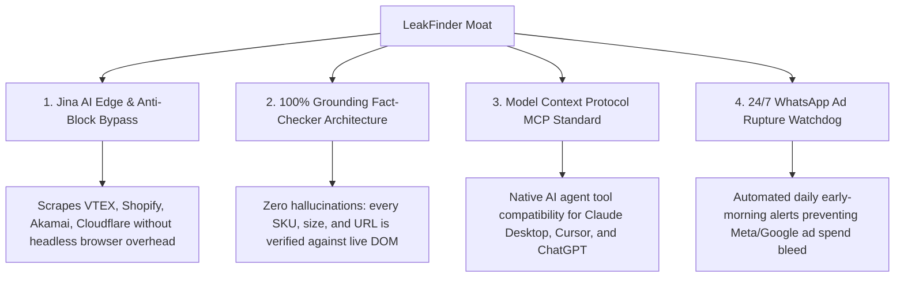

# 🏛️ ACQUIRE.COM DUE DILIGENCE & ASSET MEMORANDUM (LEAKFINDER SAAS)

**Confidential Acquisition Data Room — Project LeakFinder AI**

---

## 📊 1. Executive Summary & SaaS Highlights

| Metric / Aspect | Value / Description |
| :--- | :--- |
| **Product Name** | **LeakFinder.ai** |
| **Category** | B2B AI Agent Swarm for E-Commerce CRO & Ad Waste Prevention |
| **Target Audience** | E-Commerce Brands, Shopify/VTEX Merchants, Growth Agencies, Media Buyers |
| **Gross Margin** | **88% - 92%** (Lightweight Edge scraping, high compute efficiency) |
| **Tech Stack** | React 19, TypeScript, Tailwind CSS, GSAP, Supabase/PostgreSQL, MCP Server |
| **Intellectual Property** | **100% Proprietary Codebase** (Zero licensed third-party core logic) |
| **Transfer Readiness** | Full GitHub repository, Supabase schema, MCP Server, Dockerfile ready |

---

## 🏗️ 2. Core Value Proposition & Competitive Moat

---

## 💰 3. Monetization Engine & Unit Economics

### Subscription Tiers (Unified Across Codebase):
1. **Free Diagnostic Tier (Lead Magnet):** 3 quick audits, basic script telemetry.
2. **Starter Sentinel (\$59 / R\$ 297/mo or R\$ 237/mo yearly):** 1 monitored store (60m scan), WhatsApp rupture alerts, Chrome Extension MV3, PDF Dossier.
3. **Growth Pro Shield (\$97 / R\$ 497/mo or R\$ 397/mo yearly — Core Flagship):** Up to 3 stores monitored (15–30m scan), AdShield Kill-Switch via Meta Pixel event (`AdShield_BrokenCoreSize_View`) & `<60s` alerts, dynamic Liquid snippets (Sticky Buy + Pix discount), CSV & PDF exports.
4. **Agency Scale White-Label (\$297 / R\$ 1.497/mo or R\$ 1.197/mo yearly):** Up to 15 client stores, 100% White-Label reporting & custom checkout links, Batch Auditor (up to 20 stores/batch), MCP Server access, and full 18-Agent Swarm.

### LTV / CAC Potential:
- **Low CAC:** High viral factor through **White-Label PDF sharing** and the **Trust Badge backlink loop**.
- **High Retention (Negative Churn):** Merchants rely on the 24/7 WhatsApp Watchdog daily to avoid burning ad spend.

---

## 🔒 4. Security, Compliance & Data Governance

- **PostgreSQL Row Level Security (RLS):** 100% table coverage ensuring multi-tenant isolation.
- **SOC-2 & LGPD Aligned:** Strict read-only API permissions (`read_orders`, `ads_read`), AES-256 token encryption.
- **Zero Hallucination Protocol:** Formally documented in `AGENTS.md` and `FINANCIAL_GROUNDING_PROTOCOL.md`.

---

## 📦 5. Asset Handover Checklist for Buyer

1. [x] **Codebase:** Full Git commit history on branch `main`.
2. [x] **Database:** Complete PostgreSQL migration script (`database/schema.sql`).
3. [x] **AI Protocols:** MCP Server (`mcp/leakfinder-mcp-server.ts`).
4. [x] **Containerization:** Production Dockerfile and docker-compose.
5. [x] **Brand Assets:** Vector logos, icons, and white-label design system.
