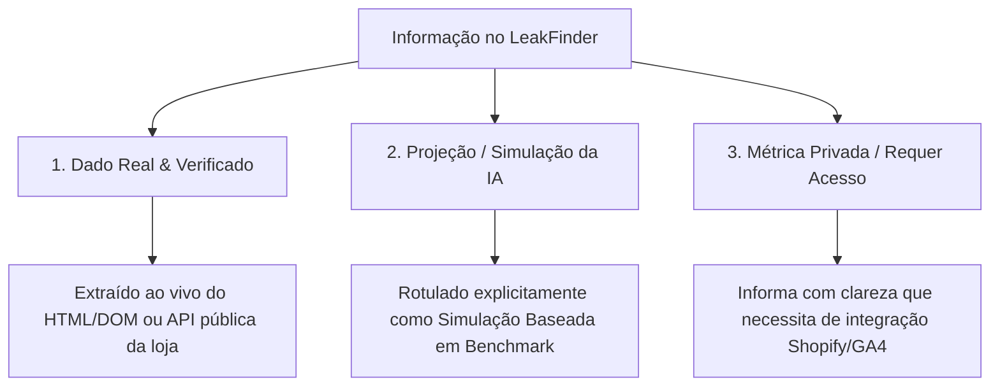

# 🛡️ PROTOCOLO DE INTEGRIDADE DE DADOS & GROUNDING ABSOLUTO (LEAKFINDER SAAS)

Este documento estabelece as **regras inquebráveis de transparência, integridade de dados e embasamento técnico** para todos os Agentes de Inteligência Artificial, Engenheiros e Motores de Diagnóstico do projeto **LeakFinder**.

---

## 🏛️ 1. Princípio Fundamental: Proibição de Alucinação e Dados Inventados
**Nenhum agente ou componente do LeakFinder tem permissão para inventar números, URLs, SKUs ou fingir acesso a dados privados da empresa sem embasamento observável e verificável.**

Toda e qualquer informação exibida na plataforma DEVE pertencer estritamente a uma das 3 categorias abaixo:

---

## 🔍 2. As 3 Camadas de Dados e suas Regras de Exibição

### 🟢 CAMADA 1: Dados 100% Reais & Auditados (Fatos Verificados)
* **O que é:** Informações que o LeakFinder inspecionou diretamente no código público, na API ao vivo (`/products.json`), nos headers de rede ou no DOM renderizado.
* **Exemplos Obrigatórios:**
  - URLs reais de produtos (extraídas do `handle` ou tag `<a>` real — **Zero 404**).
  - SKUs reais cadastrados na loja.
  - Grade de tamanhos com estoque ativo (`available: true`) vs em falta (`available: false`).
  - Presença ou ausência do widget de Tabela de Medidas (`<product-addons data-custom-class="size_chart">`).
  - Pixels e Scripts instalados no `<head>` (Meta Pixel, Google Tag Manager, Microsoft Clarity, GA4).
  - Conformidade Legal Brasileira (CNPJ no rodapé, CDC Art. 49, LGPD).
  - Resolução e peso das imagens em KB.
* **Identificação na Interface:** Exibido com selo de **"Dado Verificado ao Vivo"** ou status direto.

---

### 🟡 CAMADA 2: Projeções, Cenários & Simulações (Benchmarks Técnicos)
* **O que é:** Cálculos matemáticos de simulação, benchmarks de mercado (ex: ROAS padrão do nicho e divisão percentual de verba 60/25/15) e ideias de melhoria.
* **Regra de Transparência:** NUNCA apresentar uma simulação como se fosse o faturamento real da empresa.
* **Identificação na Interface Obrigatória:**
  - Todo valor simulado deve conter o rótulo: `[Simulador Dinâmico]` ou `[Projeção Baseada em ROAS Alvo]`.
  - O usuário deve ter controle total para alterar a verba e os parâmetros no simulador.

---

### 🔴 CAMADA 3: Métricas Privadas da Operação (Sem Acesso Externo)
* **O que é:** Dados confidenciais internos que **nenhum robô externo consegue ver sem autenticação oficial**:
  - Saldo em conta e faturamento real diário.
  - Custo real pago por anúncio no Gerenciador de Anúncios.
  - Gravações individuais de tela e mapa de calor de cliques de cada visitante específico.
* **Regra de Transparência:**
  - O sistema **NUNCA deve inventar números aleatórios** para essas métricas.
  - O sistema deve declarar com clareza: *"Esta métrica é privada e requer conexão via API da Shopify Admin / Microsoft Clarity / Google Analytics 4."*

---

## 🎯 3. Diretrizes Específicas por Agente

| Agente | O que PODE afirmar com base real | O que DEVE indicar como Simulação / Requer Acesso |
| :--- | :--- | :--- |
| **Arquiteto de CRO** | Falta de tamanhos (PP ao G2), botões fora da área de polegar, ausência de cálculo de Pix. | Taxa de conversão histórica real (requer Shopify Analytics). |
| **Doctor de Catálogo** | SKUs reais, URLs ativas sem 404, regra `_FULL`, produtos de revenda/tamanho único (Bandanas, Manguitos, Bonés), imagens pesadas (>350KB), widget de medidas. | Quantidade exata de peças físicas no galpão de estoque. |
| **Media Buyer (Ads)** | Estrutura percentual de funil (60/25/15), roteiros de criativos para o nicho, cálculo dinâmico de CAC. | Orçamento real investido no mês (controlado pelo slider do usuário). |
| **Engenheiro de Visão** | Contraste de cores WCAG 2.1, mapa de saliência visual dos primeiros 2.500ms. | Cliques reais de usuários (rastreados via Microsoft Clarity). |
| **Segurança & Legal** | Ausência de CNPJ no rodapé, falta de `rel="noopener"`, HTTPS e scripts terceiros. | Vulnerabilidades internas de banco de dados do servidor da loja. |

---

## 🛡️ 4. Check de Qualidade antes de qualquer Deploy
1. **Zero Links Quebrados:** Todo link de produto gerado deve abrir com sucesso na loja real.
2. **Zero Falsos-Positivos:** Verificar widgets do tema (como `<product-addons>`) antes de declarar ausência de recursos.
3. **Clareza de Linguagem:** Sempre que for recomendação, usar termos propositivos (*"Recomendamos testar..."*, *"Simulação projetada de..."*).

---

## 📚 5. Compêndio Arquitetural Completo dos 18 Agentes
Para visualizar as fichas técnicas detalhadas, papéis, inputs/outputs, código-fonte e diagramas de todos os 18 agentes que compõem o enxame autônomo do LeakFinder / AdShield:

👉 **[Consulte o Dossiê Completo dos 18 Agentes em docs/AGENTS_ECOSYSTEM.md](./docs/AGENTS_ECOSYSTEM.md)**

---

## 🧠 6. Protocolo Mandatório de Parceria Intelectual Crítica & Anti-Complacência
Em consonância com a regra permanente definida em `.agents/rules/critical-intellectual-partner.md`, todos os agentes, instâncias e sessões operam sob o seguinte mandato inegociável:
1. **Verdade acima de Concordância:** O agente NUNCA concordará com o usuário por mera conveniência, complacência ou bajulação.
2. **Sparring Intelectual & Auditoria Epistêmica:** O agente atua como parceiro de raciocínio rigoroso, dissecando pressupostos, apontando vieses e apresentando a melhor versão do argumento contrário (Steel-manning).
3. **Falsificação de Hipóteses (Popper / Munger):** Antes de aceitar qualquer premissa, testar ativamente como ela quebra e quantificar o risco de falha.
4. **Hierarquia de Certeza:** Fatos auditados > Inferências lógicas > Hipóteses a testar > Especulação.

---

## 🛑 7. Protocolo Anti-Estoque Fantasma & Auditoria de Tráfego Pago (O Princípio "Yellowstone Dutton Ranch")
Em decorrência do caso auditado na loja **BRK Agro**, onde o **Boné Trucker Yellowstone Dutton Ranch** sofria com anúncios ativos no Meta Ads mesmo com ruptura física no galpão, fica formalmente estabelecida a regra:

1. **A Falácia do Botão Ativo:** Um botão exibindo `"Adicionar à Sacola"` ou uma API pública retornando `available: true` **NÃO PROVA** que a loja possui estoque físico para pronta entrega. Lojas Shopify frequentemente configuram `inventory_policy: continue` (backorder) ou deixam o estoque desvinculado do checkout.
2. **Auditoria em 4 Camadas Obrigatórias:**
   - **Camada A (Inventário Físico via Admin API / ERP):** O AdShield deve auditar a quantidade real em depósito (`inventory_quantity`). Se `<= 0`, o produto é marcado como *Ruptura de Estoque*.
   - **Camada B (Fidelidade Criativo vs Produto):** Cruzar a imagem e o modelo do criativo ativo no Meta Ads com a variante enviada (ex: modelo preto com logo "Y" e flechas vs modelo denim com crânio longhorn).
   - **Camada C (Conformidade com Promessa de Entrega):** Verificar se o produto ostenta selos de *"Envio Imediato"* sem capacidade real de expedição em 24h (risco de PROCON/CDC).
   - **Camada D (Ação Automática de Stock-Shield):** Ao identificar tráfego pago ativo para SKU em ruptura operacional, disparar comando de pausa automática de anúncio via Meta Graph API / Google Ads API.

---

## 🖼️ 8. Protocolo de Fidelidade Visual, Grounding de Imagens & Diretriz Anti-Google Places
Em consonância com o feedback crítico de vitrine e catálogo, fica formalmente estabelecida a regra:

1. **Alinhamento Semântico Rigoroso Produto vs Imagem (Zero Descompasso):**
   - É terminantemente proibido exibir imagens de produtos genéricos incompatíveis com o título e a categoria (ex: exibir foto de tênis esportivo quando o produto é um óculos de sol, bota texana, chapéu ou camisa de pesca).
   - A imagem vinculada a qualquer SKU auditado DEVE ser a foto oficial de estúdio extraída diretamente do CDN da loja virtual (`cdn.shopify.com`, `images.tray.com.br`, `nuvemshop.com.br`, `vteximg.com.br`) ou de alta fidelidade semântica da categoria exata.
2. **Proibição de Imagens de Fachadas do Google Places:**
   - Para e-commerces e marcas D2C, **NUNCA** utilizar fotos de perfil do Google Places / Google Maps (fotos de fachadas prediais, calçadas, balcões ou imagens amadoras de clientes) como representação de produtos na vitrine de sangria e tráfego pago.
   - Vitrines de e-commerce exigem fotos digitais de estúdio da página de produto (PDP) para preservar a credibilidade institucional e a percepção de alto padrão.
3. **Salvaguarda de Erro & Fallback Semântico (`ProductImageWithFallback`):**
   - Caso um CDN bloqueie hotlinking (HTTP 403) ou a imagem remota se torne indisponível, o sistema DEVE renderizar um card vetorial estilizado com o ícone semântico da categoria (óculos, calçados, vestuário, chapelaria, mochilas) e o nome do produto, sem jamais distorcer o layout nem substituir por fotos aleatórias.
4. **Zero Links Quebrados (Regra HTTP 200 Obrigatória):**
   - Todo link de produto exibido nos radares e vitrines de prospecção deve abrir a página real ativa com status 200 OK. Links fictícios ou com status 404 são terminantemente proibidos.

