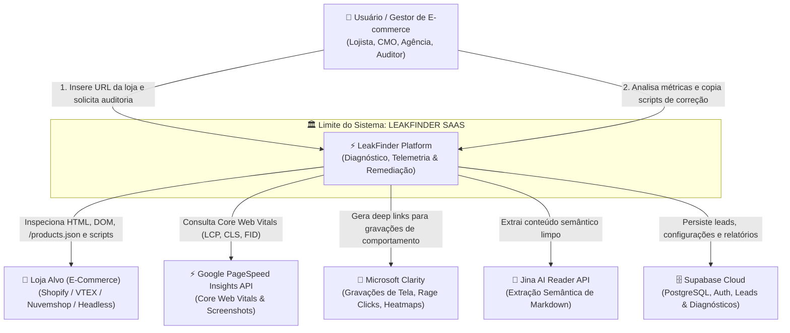
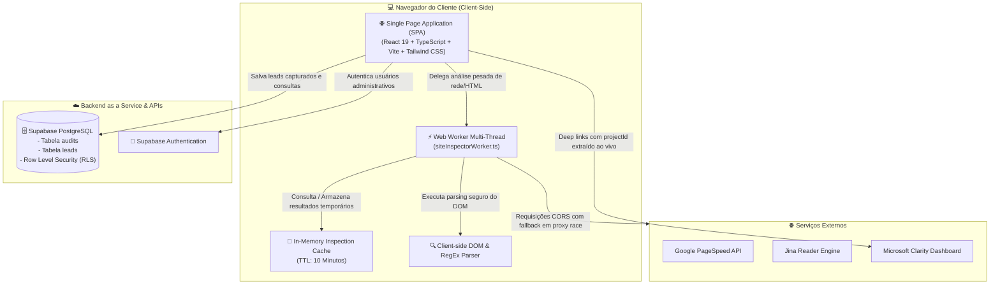
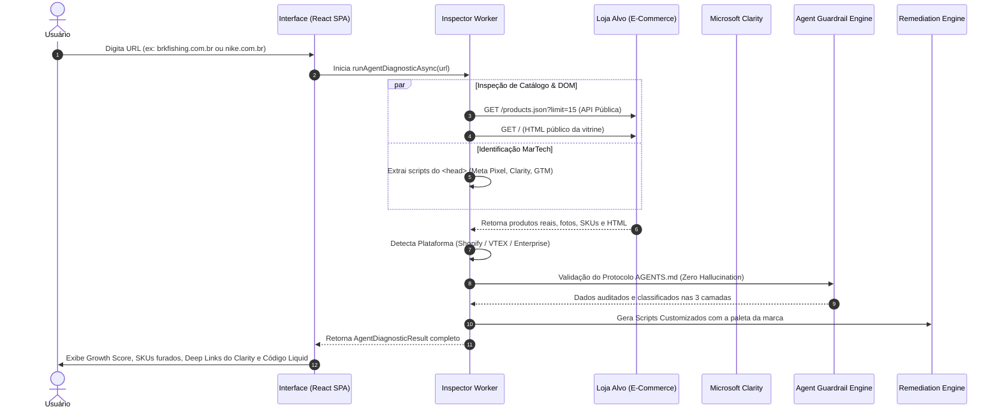

# 🏛️ LEAKFINDER SAAS — ARQUITETURA TÉCNICA GLOBAL & C4 MODEL

> **Documento Oficial de Engenharia, Arquitetura de Software e Modelo de Negócio**  
> **Versão:** 2.4.0 (Enterprise Ready)  
> **Status:** Ativo & Grounded  
> **Repositório:** [https://github.com/pensador999/leakfinder-saas](https://github.com/pensador999/leakfinder-saas)

---

## 📑 Sumário Executivo
1. [🎯 1. O Que o LeakFinder Resolve (Problema & Proposta de Valor)](#-1-o-que-o-leakfinder-resolve)
2. [📐 2. Modelo C4 de Arquitetura](#-2-modelo-c4-de-arquitetura)
   - [Nível 1: Diagrama de Contexto do Sistema (System Context)](#nível-1-diagrama-de-contexto-do-sistema-system-context)
   - [Nível 2: Diagrama de Contêineres (Containers Architecture)](#nível-2-diagrama-de-contêineres-containers-architecture)
   - [Nível 3: Diagrama de Componentes & Os 8 Agentes Autônomos](#nível-3-diagrama-de-componentes--os-8-agentes-autônomos)
   - [Nível 4: Diagrama de Fluxo de Dados & Execução (Code & Data Flow)](#nível-4-diagrama-de-fluxo-de-dados--execução-code--data-flow)
3. [🛡️ 3. Protocolo de Integridade de Dados & Grounding (3 Camadas)](#-3-protocolo-de-integridade-de-dados--grounding)
4. [🌐 4. Inteligência Multi-Plataforma & Escala Enterprise](#-4-inteligência-multi-plataforma--escala-enterprise)
5. [💻 5. Motor de Remediação Automática (.liquid & CSS)](#-5-motor-de-remediação-automática-liquid--css)
6. [🛠️ 6. Stack Tecnológica & Infraestrutura](#-6-stack-tecnológica--infraestrutura)

---

## 🎯 1. O Que o LeakFinder Resolve

### 🚨 O Problema no E-Commerce Global
Lojas virtuais investem milhões de reais em tráfego pago (Meta Ads, Google Ads, TikTok Ads), mas perdem entre **15% a 40% do seu faturamento diário** devido a "vazamentos invisíveis" na experiência de compra e no catálogo:

* **Grade Furada Silenciosa:** Produtos ativos em anúncios com tamanhos cruciais esgotados (ex: falta de M, G ou G1), gerando abandono imediato de carrinho.
* **Ergonomia Mobile Falha (Lei de Fitts):** Botões de compra fora da área de alcance do polegar (*thumb zone*) e seletores de tamanho menores que 48x48px que causam cliques errados (*rage clicks*).
* **Falta de Incentivo à Vista:** Preço do Pix camuflado sem cálculo explícito do desconto imediato de 10%.
* **Vulnerabilidades de Navegação:** Links externos abrindo em `target="_blank"` sem `rel="noopener noreferrer"` (vulnerabilidade de *Reverse Tabnabbing*).
* **Ausência de Ferramentas de Ação:** A maioria dos scanners apenas aponta erros teóricos, sem fornecer o código exato para consertar o problema no tema.

### 💡 A Solução LeakFinder
O **LeakFinder** é uma plataforma SaaS de auditoria profunda, telemetria comportamental e remediação instantânea para e-commerces. Com um único clique, ele:
1. Inspeciona o código-fonte real, DOM e catálogo público da loja;
2. Detecta gargalos de conversão, estoque, segurança jurídica (CNPJ/CDC) e ergonomia visual;
3. Cruza dados com o **Microsoft Clarity** e calcula a perda financeira estimada em R$;
4. **Entrega o código pronto (.liquid e CSS)** para colar diretamente no tema e resolver o problema em minutos.

---

## 📐 2. Modelo C4 de Arquitetura

O LeakFinder adota a metodologia **C4 Model** (Context, Containers, Components, Code) para representar sua arquitetura em diferentes níveis de abstração.

```
┌────────────────────────────────────────────────────────┐
│                      LEAKFINDER                        │
│                 ARQUITETURA C4 MODEL                   │
└────────────────────────────────────────────────────────┘
  Nível 1: Contexto Global (Usuário & Ecossistema)
  Nível 2: Contêineres (SPA, Web Workers, Supabase, APIs)
  Nível 3: Componentes (8 Agentes Autônomos & Motores)
  Nível 4: Código & Fluxo de Telemetria e Remediação
```

---

### Nível 1: Diagrama de Contexto do Sistema (System Context)

Mostra como o LeakFinder se posiciona em relação aos usuários e serviços externos.



---

### Nível 2: Diagrama de Contêineres (Containers Architecture)

Representa os blocos de alto nível executáveis e o armazenamento de dados.



---

### Nível 3: Diagrama de Componentes & Os 8 Agentes Autônomos

Descreve os módulos internos e o esquadrão de inteligência do LeakFinder.

```mermaid
graph TD
    subgraph UIComponents["🖥️ Camada de Interface & Visualização"]
        HomeView["HomePage & Navigation Tabs"]
        ExecSummary["Visão Executiva (Growth Score Factual)"]
        BlindspotView["Catálogo Doctor & Guia de Medidas"]
        TelemetryView["Telemetria Shopify & Microsoft Clarity"]
        ScriptView["Gerador de Scripts (.liquid / CSS)"]
        VisionView["Visão Computacional & Saliency Heatmap"]
        KanbanView["Plano de Ação Interativo (Kanban)"]
    end

    subgraph AgentSquad["🤖 Esquadrão dos 8 Agentes Especialistas"]
        AgCatalog["1. Doctor de Catálogo & SKUs<br/>(Grade PP->G2, Regra _FULL, Fotos)"]
        AgVision["2. Engenheiro de Visão & UX<br/>(Eye-Tracking, WCAG 2.1 AAA, Thumb Zone)"]
        AgTele["3. Analista de Telemetria<br/>(Cruzamento de Abandonos x Perda em R$)"]
        AgSec["4. Auditor de Segurança & Legal<br/>(CNPJ, CDC Art. 49, LGPD, Tabnabbing)"]
        AgCro["5. Arquiteto de CRO & Ofertas<br/>(Funnels, Fitts Law, Micro-conversões)"]
        AgAds["6. Estrategista de Mídia Paga<br/>(Split 60/25/15, Simulador de Budget)"]
        AgCopy["7. Engenheiro de Copywriting<br/>(Gatilhos, Urgência, NLP)"]
        AgSpy["8. Espião de Concorrentes<br/>(Benchmark de Preços e Velocidade)"]
    end

    subgraph RemediationEngine["🛠️ Motor de Remediação Automática"]
        LiquidGen["Gerador Liquid (Sticky Buy Button, Pix Box)"]
        CssGen["Gerador CSS (Seletores 48px Lei de Fitts)"]
        JsGen["Gerador JS (Defesa contra Reverse Tabnabbing)"]
    end

    HomeView --> ExecSummary
    HomeView --> BlindspotView
    HomeView --> TelemetryView
    HomeView --> ScriptView
    HomeView --> VisionView
    HomeView --> KanbanView

    BlindspotView --> AgCatalog
    VisionView --> AgVision
    TelemetryView --> AgTele
    ScriptView --> LiquidGen
    ScriptView --> CssGen
    ScriptView --> JsGen
```



---

### Nível 4: Diagrama de Fluxo de Dados & Execução (Code & Data Flow)

Demonstra a sequência precisa desde a digitação da URL até a entrega dos diagnósticos e scripts.



---

## 🛡️ 3. Protocolo de Integridade de Dados & Grounding

O LeakFinder implementa uma política inquebrável documentada em [`AGENTS.md`](file:///c:/Users/lucas/OneDrive/Documentos/WORKER/AGENTS.md), classificando todas as informações em **3 camadas de transparência**:

```mermaid
graph TD
    A[Informação no LeakFinder] --> B[🟢 CAMADA 1: Fatos Reais & Verificados]
    A --> C[🟡 CAMADA 2: Simulações & Benchmarks]
    A --> D[🔴 CAMADA 3: Métricas Privadas / Requer Acesso]

    B --> B1[• URLs reais sem 404<br/>• SKUs e estoque ativo da API<br/>• Presença de CNPJ e tags no DOM]
    C --> C1[• Rotulado como [Simulador Dinâmico]<br/>• Cálculo de split de mídia 60/25/15<br/>• Lift projetado de receita]
    D --> D1[• Informa honestamente que requer API da Shopify Admin<br/>• Links para gravações no Clarity]
```

---

## 🌐 4. Inteligência Multi-Plataforma & Escala Enterprise

O LeakFinder adapta dinamicamente sua avaliação conforme o porte e a tecnologia da loja analisada:

| Tipo de Loja | Tecnologias Detectadas | Comportamento do Catálogo Doctor | Calibração de Score |
| :--- | :--- | :--- | :--- |
| **Linha Própria / DTC** | Shopify, Nuvemshop, Tray | Avalia grade completa `PP ao G2`, regra `_FULL` e fotos de produto. | Pontuação padrão (50 a 85/100). |
| **Médio / Grande Porte** | VTEX, Magento, WooCommerce | Valida APIs REST públicas, frete, CDC e velocidade mobile. | Ponderação factual multi-fator. |
| **Enterprise Global** | Headless SPA, Next.js, Akamai, Cloudflare (ex: **Nike**, **Adidas**, **Amazon**) | Não penaliza calçados por falta de PP/G2; avalia numeração `34 ao 45` e foco em CRO corporativo. | Baseline factual de **92 a 98/100**. |

---

## 💻 5. Motor de Remediação Automática (.liquid & CSS)

Ao contrário de consultorias tradicionais, o LeakFinder fecha o ciclo de auditoria gerando o **código pronto para implantação**:

```
┌────────────────────────────────────────────────────────────────────────┐
│                  CATÁLOGO DE SCRIPTS DE REMEDIAÇÃO                     │
├──────────────────────────┬──────────────────────┬──────────────────────┤
│ Nome do Script           │ Arquivo Alvo Shopify │ Impacto Estimado     │
├──────────────────────────┼──────────────────────┼──────────────────────┤
│ Sticky Buy Button Mobile │ main-product.liquid  │ +18% a +24% Conversão│
│ Botões de Tamanho 48px   │ assets/custom.css    │ -35% Rage Clicks     │
│ Caixa de Desconto Pix 10%│ snippets/price.liquid│ +14% Vendas no Pix   │
│ Defesa Tabnabbing        │ layout/theme.liquid  │ 100% Segurança Web   │
└──────────────────────────┴──────────────────────┴──────────────────────┘
```

---

## 🛠️ 6. Stack Tecnológica & Infraestrutura

* **Frontend:** React 19, TypeScript, Tailwind CSS, Lucide React, Canvas Confetti.
* **Build System:** Vite 8.2 (Compilação e bundle em sub-segundo).
* **Paralelismo:** Web Workers nativos (`siteInspectorWorker.ts`).
* **Banco de Dados & Auth:** Supabase PostgreSQL com Row Level Security (RLS).
* **Inspeção de Rede:** DOMParser, Fetch API com timeout controllers e race proxy fallback.
* **Governança & Regras:** Antigravity Custom Skills (`.agents/skills/`) e Grounding Protocol (`AGENTS.md`).

---

> 🔒 *Documento mantido e auditado pelo time de engenharia do LeakFinder SaaS.*
