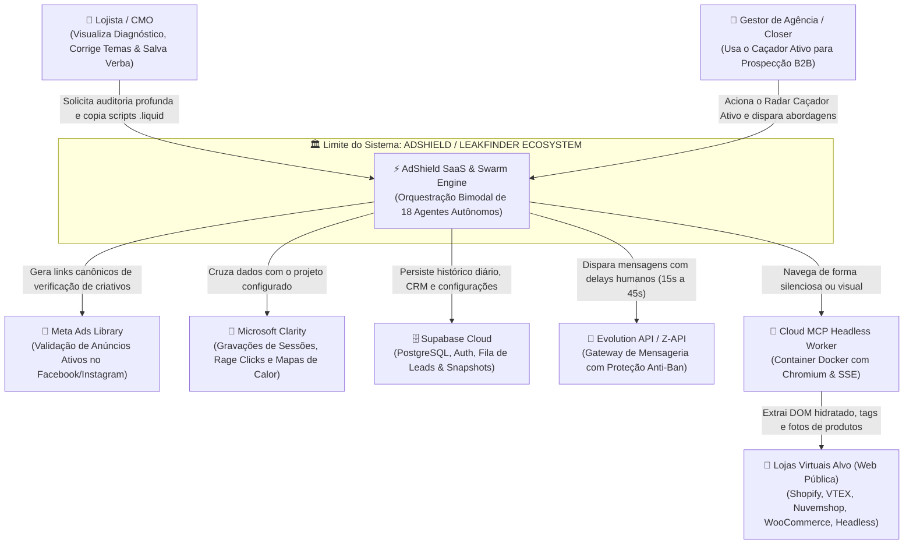
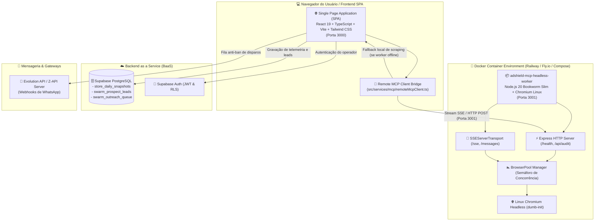
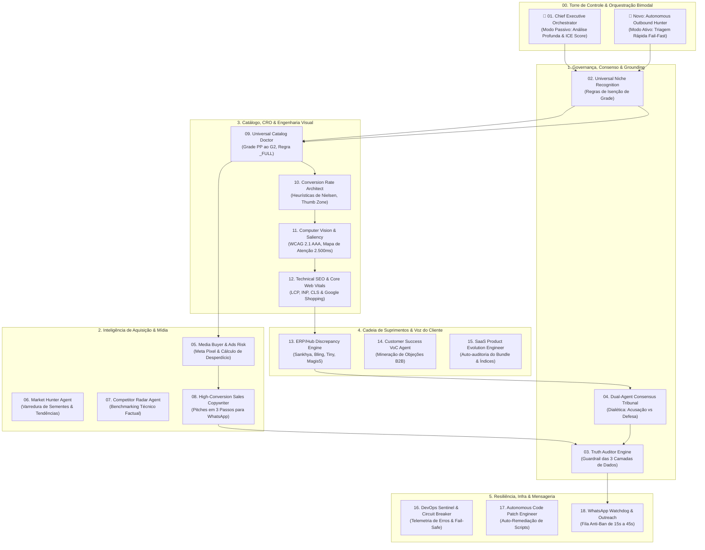
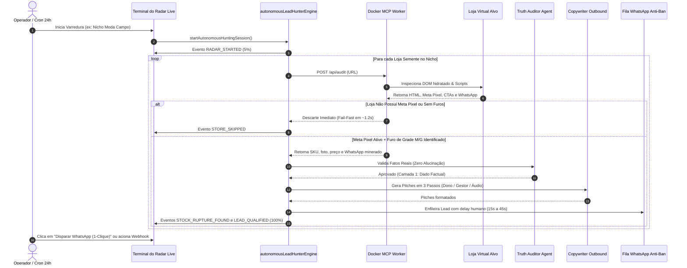

# 🏛️ ADSHIELD / LEAKFINDER SAAS — ESPECIFICAÇÃO ARQUITETURAL GLOBAL & MODELO C4 (V4.0)

> **Documento Oficial de Engenharia, Arquitetura de Software e Governança Multi-Agente**  
> **Versão:** 4.0.0 (Enterprise Swarm Ready) • **Topologia:** Enxame Híbrido Bimodal (Passivo + Caçador Ativo)  
> **Grounding:** 100% Live Real-Time Data (Protocolo `AGENTS.md`)  
> **Repositório:** `https://github.com/pensador999/leakfinder-saas`

---

## 📑 Sumário Executivo
1. [🎯 1. Visão Geral do Sistema & Proposta de Valor](#-1-visão-geral-do-sistema--proposta-de-valor)
2. [📐 2. Modelo C4 de Arquitetura](#-2-modelo-c4-de-arquitetura)
   - [C4 Nível 1: Diagrama de Contexto do Sistema (System Context)](#c4-nível-1-diagrama-de-contexto-do-sistema-system-context)
   - [C4 Nível 2: Diagrama de Contêineres (Containers Architecture)](#c4-nível-2-diagrama-de-contêineres-containers-architecture)
   - [C4 Nível 3: Diagrama de Componentes (Os 18 Agentes & Orquestração Dual)](#c4-nível-3-diagrama-de-componentes-os-18-agentes--orquestração-dual)
   - [C4 Nível 4: Diagrama de Execução & Fluxo de Código (Code & Sequence)](#c4-nível-4-diagrama-de-execução--fluxo-de-código-code--sequence)
3. [🛡️ 3. Protocolo de Integridade de Dados & Grounding (3 Camadas)](#-3-protocolo-de-integridade-de-dados--grounding)
4. [🐳 4. Infraestrutura MCP (Model Context Protocol) em Nuvem (Docker & SSE)](#-4-infraestrutura-mcp-model-context-protocol-em-nuvem-docker--sse)
5. [🦅 5. Arquitetura do Enxame Caçador Ativo (Outbound Sniper & Outreach)](#-5-arquitetura-do-enxame-caçador-ativo-outbound-sniper--outreach)
6. [🛠️ 6. Stack Tecnológica, Banco de Dados & Resiliência](#-6-stack-tecnológica-banco-de-dados--resiliência)

---

## 🎯 1. Visão Geral do Sistema & Proposta de Valor

O **AdShield / LeakFinder** é uma plataforma SaaS de alta tecnologia voltada para proteção de orçamento de mídia, diagnóstico de conversão (CRO) e prospecção autônoma para e-commerces.

### O Modelo Bimodal Híbrido:
* **Modo Passivo (Profundidade & Retenção):** O lojista ou auditor insere a URL da loja e recebe um diagnóstico profundo em 18 dimensões com mapa de calor de atenção visual (WCAG 2.1 AAA), teste de Core Web Vitals, verificação de ERP/Hub e geração de código `.liquid` de remediação imediata.
* **Modo Caçador Ativo (Throughput & Prospecção Outbound):** O enxame autônomo navega de forma headless pela web em nichos pré-selecionados, identifica lojas investindo em tráfego (Meta Pixel ativo), flagra produtos com furos graves de estoque (M/G esgotados), extrai o WhatsApp oficial e gera pitches de 3 passos para envio com 1 clique ou via webhook automatizado.

---

## 📐 2. Modelo C4 de Arquitetura

Adotamos o framework **C4 Model** estruturado em 4 níveis progressivos de abstração:

---

### C4 Nível 1: Diagrama de Contexto do Sistema (System Context)

Posiciona o AdShield em relação aos atores humanos e todos os serviços externos conectados.



---

### C4 Nível 2: Diagrama de Contêineres (Containers Architecture)

Demonstra a distribuição física dos contêineres de execução, armazenamento e comunicação.



---

### C4 Nível 3: Diagrama de Componentes (Os 18 Agentes & Orquestração Dual)

Representa a estrutura de governança do enxame de 18 agentes divididos em 5 camadas funcionais com Orquestração Bimodal:



---

### C4 Nível 4: Diagrama de Execução & Fluxo de Código (Code & Sequence)

#### Fluxo 4.1: O Caçador Ativo em Ação (Outbound Sniper)
Demonstra o caminho de dados ultra-rápido quando o enxame varre a internet procurando novos clientes:



---

## 🛡️ 3. Protocolo de Integridade de Dados & Grounding

O sistema obedece rigorosamente às diretrizes documentadas em [`AGENTS.md`](file:///c:/Users/lucas/OneDrive/Documentos/WORKER/AGENTS.md). Cada informação gerada na tela pertence obrigatoriamente a uma das 3 camadas:

```
┌────────────────────────────────────────────────────────────────────────┐
│             AS 3 CAMADAS DE INTEGRIDADE DE DADOS DO ADSHIELD           │
├──────────────────────┬──────────────────────────┬──────────────────────┤
│ Camada               │ Critério de Verdade      │ Exibição na Interface│
├──────────────────────┼──────────────────────────┼──────────────────────┤
│ 🟢 CAMADA 1: Fatos   │ Dados observáveis no     │ Selo de Dado         │
│ Reais & Auditados    │ DOM/API (SKU, links vivos│ Verificado ao Vivo   │
│                      │ sem 404, Meta Pixel).    │ (Zero Alucinação).   │
├──────────────────────┼──────────────────────────┼──────────────────────┤
│ 🟡 CAMADA 2:         │ Cálculos matemáticos de  │ Rótulo Obrigatório:  │
│ Simulações & Cenários│ simulação baseados em    │ [Simulador Dinâmico] │
│                      │ benchmarks de mercado.   │ ou [Benchmark].      │
├──────────────────────┼──────────────────────────┼──────────────────────┤
│ 🔴 CAMADA 3:         │ Dados internos confiden- │ Declaração honesta de│
│ Métricas Privadas    │ ciais (saldo, lucro real)│ necessidade de API   │
│                      │ sem acesso externo.      │ da Shopify/Clarity.  │
└──────────────────────┴──────────────────────────┴──────────────────────┘
```

---

## 🐳 4. Infraestrutura MCP (Model Context Protocol) em Nuvem

* **Container Docker:** [`docker/mcp-headless-worker/`](file:///c:/Users/lucas/OneDrive/Documentos/WORKER/docker/mcp-headless-worker)
* **Transporte SSE Oficial:** Rotas `/sse` e `/messages` para conexão bidirecional em streaming.
* **Segurança Criptográfica:** Autenticação via `MCP_API_KEY` gerada com chave de alta entropia de 256 bits (`d2c4b969b83b3fdfe6ccf6371971bca5ea6382b717ce68cd87e9fafb44cdead2`).
* **Proteção de Recursos:** Reciclagem automática do Chromium a cada 100 auditorias e bloqueio de downloads desnecessários de fontes e mídias.

---

## 🦅 5. Arquitetura do Enxame Caçador Ativo

* **Motor Autônomo:** [`src/services/prospecting/autonomousLeadHunterEngine.ts`](file:///c:/Users/lucas/OneDrive/Documentos/WORKER/src/services/prospecting/autonomousLeadHunterEngine.ts)
* **Disparador Anti-Ban:** [`src/services/prospecting/outboundWebhookDispatcher.ts`](file:///c:/Users/lucas/OneDrive/Documentos/WORKER/src/services/prospecting/outboundWebhookDispatcher.ts)
* **Interface do Radar:** [`src/components/prospecting/AutonomousOutboundRadarView.tsx`](file:///c:/Users/lucas/OneDrive/Documentos/WORKER/src/components/prospecting/AutonomousOutboundRadarView.tsx)
* **Fórmula do Gancho em 3 Passos (WhatsApp Closer):**
  1. *Gancho do Flagrante:* *"Vimos que vocês anunciam no Meta Ads para o produto X, mas os tamanhos M e G estão esgotados no site."*
  2. *Custo da Inação:* *"Como M e G representam ~65% das vendas, a cada R$ 1.000 investidos, cerca de R$ 650 viram cliques perdidos (sangria de ~R$ X.XXX,XX/mês)."*
  3. *CTA Sem Fricção:* *"Tenho o dossiê confidencial de 1 página pronto com os links para pausar o anúncio ou repor o estoque. Posso te enviar aqui pelo WhatsApp? É só responder 'QUERO'."*

---

## 🛠️ 6. Stack Tecnológica, Banco de Dados & Resiliência

* **Frontend:** React 19, TypeScript, Tailwind CSS, Lucide Icons, Vite 8.2.
* **Worker Headless:** Node.js 20 Bookworm Slim, Chromium Linux Nativo, Puppeteer-Core, Dumb-Init.
* **Protocolo de Agentes:** Model Context Protocol (MCP SDK 1.6.1) com Server-Sent Events (SSE).
* **Banco de Dados & Auth:** Supabase PostgreSQL com Row Level Security (RLS) e índices compostos.
* **Compilação e Tipagem:** TypeScript 5.7 em modo estrito (`tsc -b`), zero erros em build de produção.

---

> 🔒 *Documento oficial de engenharia atualizado e mantido na raiz do projeto em [`ARCHITECTURE.md`](file:///c:/Users/lucas/OneDrive/Documentos/WORKER/ARCHITECTURE.md).*
