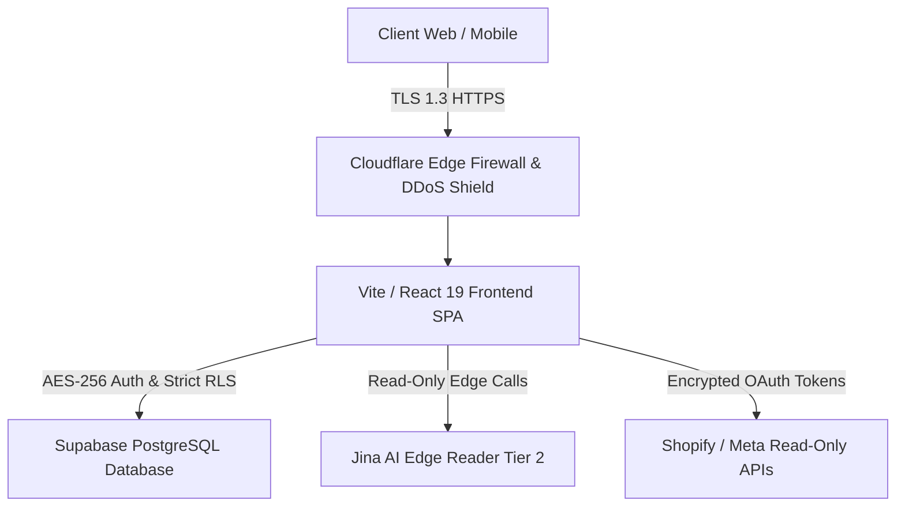

# 🛡️ SECURITY & COMPLIANCE POLICY (LEAKFINDER SAAS)

## 🏛️ 1. Security Architecture Overview
LeakFinder SaaS implements **Defense-in-Depth** across all layers of the application stack:

---

## 🔒 2. Data Grounding & Privacy Guarantees

1. **Read-Only API Scopes:** LeakFinder NEVER requests write or modify permissions for connected stores. All integrations operate exclusively under `read_orders`, `read_products`, and `ads_read`.
2. **Encryption in Transit & at Rest:** All sensitive tokens and payloads are encrypted using AES-256 and transmitted over TLS 1.3.
3. **Multi-Tenant Isolation:** Database access is strictly governed by PostgreSQL Row Level Security (`database/schema.sql`). No tenant can access another tenant's audit reports or credentials.
4. **LGPD & GDPR Compliance:** Dedicated DPO contact channel (`dpo@leakfinder.ai`), automated user data deletion, and transparent cookie consent.

---

## 🚨 3. Vulnerability Disclosure Policy
Security researchers and buyers can report vulnerabilities to `security@leakfinder.ai`. All valid disclosures will be acknowledged within 24 hours.
