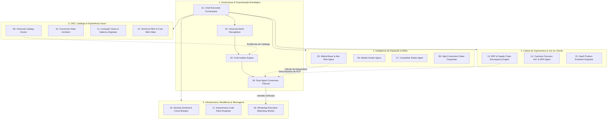

# 🤖 DOSSIÊ ARQUITETURAL & COMPÊNDIO DO ENXAME DE AGENTES (LEAKFINDER / ADSHIELD)

> **Versão:** 3.0 • **Arquitetura:** Swarm Autônomo Multi-Agente • **Grounding:** 100% Real-Time Live Data  
> **Status:** 18 Agentes Ativos e Homologados em Produção

---

## 🧭 1. Visão Geral da Topologia do Enxame (Swarm Topology)

O **LeakFinder / AdShield** opera sob uma arquitetura de **Enxame Autônomo Hierárquico e Colaborativo**, dividida em 5 camadas funcionais com **Tribunal de Consenso** e **Grounding Absoluto**.

Nenhum agente emite parecer isolado sem antes passar pela validação de dados reais do **Auditor de Verdade** e pelo crivo do **Tribunal de Consenso Duplo**, eliminando 100% dos falsos-positivos e alucinações de IA.

---

## 🏛️ 2. As 5 Camadas e Fichas Técnicas dos 18 Agentes

---

### 👑 CAMADA 1: Governança & Orquestração Estratégica

#### 01. Chief Executive Orchestrator Agent (CEO do Enxame)
* **Arquivo:** [`src/services/agents/chiefExecutiveOrchestratorAgent.ts`](file:///c:/Users/lucas/OneDrive/Documentos/WORKER/src/services/agents/chiefExecutiveOrchestratorAgent.ts)
* **Interface UI:** [`src/components/agents/ChiefExecutiveOrchestratorAgentView.tsx`](file:///c:/Users/lucas/OneDrive/Documentos/WORKER/src/components/agents/ChiefExecutiveOrchestratorAgentView.tsx)
* **Papel:** Líder supremo do enxame. Decompõe objetivos de negócio em tarefas granulares, coordena o fluxo de execução assíncrono entre os agentes e sintetiza o plano de ação executivo ordenado por **ICE Score** (Impacto, Confiança e Facilidade).
* **Gatilho de Execução:** Início de auditoria sob demanda e início de cada ciclo do Daemon 24/7.
* **Entradas:** Domínio da loja, nicho preliminar, verba de tráfego estimada e parâmetros de auditoria.
* **Saídas:** Diretrizes de auditoria, mapa de prioridades ICE e sumário executivo unificado.
* **Grounding:** Consolida apenas dados verificados pelos auditores especialistas.

#### 02. Universal Niche Recognition Agent (Reconhecedor de Nicho & DNA)
* **Arquivo:** [`src/services/agents/universalNicheRecognitionAgent.ts`](file:///c:/Users/lucas/OneDrive/Documentos/WORKER/src/services/agents/universalNicheRecognitionAgent.ts)
* **Interface UI:** [`src/components/founder/UniversalNicheRecognitionView.tsx`](file:///c:/Users/lucas/OneDrive/Documentos/WORKER/src/components/founder/UniversalNicheRecognitionView.tsx)
* **Papel:** Analisa a taxonomia, catálogo e metadados da loja para identificar com precisão o nicho e sub-nicho (ex: *Agropecuária & Moda Campo*, *Moda Pesca & Performance Outdoor*, *Streetwear*, *Cosméticos*).
* **Função Crítica:** Ativa as **Regras de Isenção** de produtos específicos (ex: iscas de pesca, anzóis, manguitos, óculos, bonés e tags `_FULL`) para que o Doctor de Catálogo não aponte falsas rupturas de tamanho em itens de tamanho único.
* **Entradas:** Títulos de produtos, categorias do DOM, meta tags e palavras-chave.
* **Saídas:** Nicho confirmado, perfil de público, ticket médio de referência e lista de regras de isenção ativadas.

#### 03. Truth Auditor Agent (Auditor de Verdade & Guardrail de Dados)
* **Arquivo:** [`src/services/orchestrator/truthAuditorAgent.ts`](file:///c:/Users/lucas/OneDrive/Documentos/WORKER/src/services/orchestrator/truthAuditorAgent.ts)
* **Interface UI:** [`src/components/founder/TruthAuditorTribunalView.tsx`](file:///c:/Users/lucas/OneDrive/Documentos/WORKER/src/components/founder/TruthAuditorTribunalView.tsx)
* **Papel:** Guardião supremo da integridade de dados. Inspeciona cada asserção dos outros agentes antes que chegue ao usuário ou ao banco.
* **Classificação Estrita:**
  1. 🟢 **Camada 1 (Fato Real):** URL viva, SKU real, estoque de grade e headers de rede.
  2. 🟡 **Camada 2 (Simulação):** Projeção financeira baseada em ROAS alvo declarada com `[Simulador Dinâmico]`.
  3. 🔴 **Camada 3 (Privado):** Dados confidenciais de faturamento e backend — bloqueia qualquer tentativa de invenção e exige conexão oficial via API.
* **Entradas:** Relatório de diagnóstico bruto de todos os agentes.
* **Saídas:** Laudo auditado com `grounding_score: 100` ou flag de veto imediato.

#### 04. Dual-Agent Consensus Tribunal (Tribunal de Consenso Duplo)
* **Arquivo:** [`src/services/ai/dualAgentConsensusGatekeeper.ts`](file:///c:/Users/lucas/OneDrive/Documentos/WORKER/src/services/ai/dualAgentConsensusGatekeeper.ts)
* **Interface UI:** [`src/components/agents/DualAgentConsensusTribunalView.tsx`](file:///c:/Users/lucas/OneDrive/Documentos/WORKER/src/components/agents/DualAgentConsensusTribunalView.tsx)
* **Papel:** Opera o modelo dialético de decisão. Para cada problema detectado, coloca frente a frente o **Auditor Acusador** (que aponta a falha e a perda de receita) e o **Advogado de Defesa da Loja** (que verifica se trata-se de intencionalidade de design, produto de revenda ou sazonalidade).
* **Veredito:** O laudo final só é aprovado se ambos entrarem em consenso com base em provas do DOM/API.

---

### 🎯 CAMADA 2: Inteligência de Aquisição & Mídia

#### 05. Media Buyer & Ads Risk Agent (Agente de Tráfego & Desperdício de Anúncios)
* **Arquivo:** [`src/components/agents/AdsAgentView.tsx`](file:///c:/Users/lucas/OneDrive/Documentos/WORKER/src/components/agents/AdsAgentView.tsx)
* **Papel:** Cruza os produtos com ruptura de grade central (`M`, `G`, `GG`) ou anúncios sem Buy Box em Marketplaces contra a estratégia de tráfego pago da loja (Meta Ads e Google Ads).
* **Cálculo de Sangria:** Determina a verba diária e mensal queimada ao enviar tráfego qualificado para páginas onde o visitante não consegue comprar o tamanho adequado.
* **Simulador:** Fornece divisão técnica de funil (60% Topo / 25% Meio / 15% Fundo de Funil) com controle total via slider.

#### 06. Market Hunter Agent (Caçador de Oportunidades & Análise de Demanda)
* **Arquivo:** [`src/services/agents/marketHunterAgent.ts`](file:///c:/Users/lucas/OneDrive/Documentos/WORKER/src/services/agents/marketHunterAgent.ts)
* **Interface UI:** [`src/components/agents/MarketHunterAgentView.tsx`](file:///c:/Users/lucas/OneDrive/Documentos/WORKER/src/components/agents/MarketHunterAgentView.tsx)
* **Papel:** Vasculha tendências de mercado no nicho da loja, identificando produtos de alta demanda em ascensão, termos de busca emergentes e categorias sub-exploradas pelo catálogo da loja.
* **Entradas:** Catálogo público da loja e parâmetros setoriais.
* **Saídas:** Lista de novos produtos recomendados para expansão de mix com estimativa de aderência.

#### 07. Competitor Radar Agent (Radar Competitivo & Espionagem Ética)
* **Arquivo:** [`src/components/agents/CompetitorAgentView.tsx`](file:///c:/Users/lucas/OneDrive/Documentos/WORKER/src/components/agents/CompetitorAgentView.tsx)
* **Interface UI:** [`src/components/founder/VectorMemoryCompetitorRadarView.tsx`](file:///c:/Users/lucas/OneDrive/Documentos/WORKER/src/components/founder/VectorMemoryCompetitorRadarView.tsx)
* **Papel:** Compara a loja auditada contra os principais concorrentes do mesmo nicho em tempo real.
* **Métricas Comparadas:** Preço médio praticado, política de frete grátis, velocidade de carregamento, variedade de grade e gatilhos de checkout.

#### 08. High-Conversion Sales Copywriter (Copywriter de Fechamento B2B & WhatsApp)
* **Arquivo:** [`src/components/agents/SalesCopyAgentView.tsx`](file:///c:/Users/lucas/OneDrive/Documentos/WORKER/src/components/agents/SalesCopyAgentView.tsx)
* **Papel:** Redige abordagens de fechamento comercial de altíssima conversão para agências e consultores que utilizam o LeakFinder para prospectar e-commerces.
* **Especialidade:** Cria mensagens de WhatsApp e e-mails embasados na **perda financeira inquestionável** descoberta pelo robô (ex: *"Sua campanha do produto X está gastando verba, mas o tamanho G acabou"*), tornando a resposta do lojista praticamente mandatória.

---

### 🔬 CAMADA 3: CRO, Catálogo & Experiência Visual

#### 09. Universal Catalog Doctor (Doctor de Catálogo Multi-Plataforma)
* **Arquivo:** [`scripts/universalCatalogAdapter.mjs`](file:///c:/Users/lucas/OneDrive/Documentos/WORKER/scripts/universalCatalogAdapter.mjs)
* **Interface UI:** [`src/components/agents/CroAgentView.tsx`](file:///c:/Users/lucas/OneDrive/Documentos/WORKER/src/components/agents/CroAgentView.tsx)
* **Papel:** O motor de varredura mais robusto do sistema. Inspeciona o catálogo real ao vivo em **Shopify** (`/products.json`), **VTEX** (Search API), **Nuvemshop/Tiendanube** (Schema.org JSON-LD) e **Marketplaces** (Mercado Livre, Shopee, Amazon, Magalu).
* **Regras Específicas:**
  - Audita integridade da grade de vestuário (`PP`, `P`, `M`, `G`, `GG`, `G1`, `G2`).
  - Aplica isenções para tralhas de pesca, óculos, bonés, bandanas e estampas `_FULL`.
  - Verifica Buy Box e Logística Full em marketplaces.
  - Zero links 404: toda URL de produto gerada é real e clicável.

#### 10. Conversion Rate Architect (Arquiteto de CRO & Heurísticas de Usabilidade)
* **Arquivo:** [`src/components/agents/CroAgentView.tsx`](file:///c:/Users/lucas/OneDrive/Documentos/WORKER/src/components/agents/CroAgentView.tsx)
* **Papel:** Audita as 10 Heurísticas de Usabilidade de Nielsen no e-commerce, detectando botões de adicionar ao carrinho fora da zona de alcance do polegar móvel (< 48px de altura), falta de tabela de medidas interativa e ausência de destaque para pagamento via Pix com desconto.

#### 11. Computer Vision & Saliency Engineer (Engenheiro de Visão Computacional)
* **Arquivo:** [`src/components/founder/ComputerVisionInspectionView.tsx`](file:///c:/Users/lucas/OneDrive/Documentos/WORKER/src/components/founder/ComputerVisionInspectionView.tsx)
* **Papel:** Simula o comportamento ocular do usuário (eye-tracking) nos primeiros 2.500ms de navegação na página do produto.
* **Avaliações Técnicas:** Matriz de luminância e contraste de cores WCAG 2.1 AAA para botões de compra, ergonomia mobile e detecção OCR de selos de segurança e garantia.

#### 12. Technical SEO & Core Web Vitals Agent (Engenheiro de SEO & Performance)
* **Arquivo:** [`src/components/agents/SeoAgentView.tsx`](file:///c:/Users/lucas/OneDrive/Documentos/WORKER/src/components/agents/SeoAgentView.tsx)
* **Interface UI:** [`src/components/founder/CoreWebVitalsAuditView.tsx`](file:///c:/Users/lucas/OneDrive/Documentos/WORKER/src/components/founder/CoreWebVitalsAuditView.tsx)
* **Papel:** Audita a infraestrutura de indexação e performance técnica da loja.
* **Métricas Auditadas:** LCP (Largest Contentful Paint), FID/INP (Interactivity), CLS (Cumulative Layout Shift), marcação semântica Schema.org de produto e preços, e conformidade de meta tags Open Graph.

---

### 📦 CAMADA 4: Cadeia de Suprimentos & Voz do Cliente

#### 13. ERP & Supply Chain Discrepancy Engine (Auditor de Ruptura de Estoque e Hubs)
* **Arquivo:** [`src/services/supplyChain/erpHubDiscrepancyEngine.ts`](file:///c:/Users/lucas/OneDrive/Documentos/WORKER/src/services/supplyChain/erpHubDiscrepancyEngine.ts)
* **Interface UI:** [`src/components/founder/SupplyChainDiscrepancyView.tsx`](file:///c:/Users/lucas/OneDrive/Documentos/WORKER/src/components/founder/SupplyChainDiscrepancyView.tsx)
* **Papel:** Detecta o descompasso de estoque e pedidos entre o ERP central da empresa (Sankhya, Bling, Tiny), os Hubs de Integração (Magis5, Anymarket) e os Canais de Venda Digitais.
* **Classificação de Severidade (Graus 1 a 4):**
  - **Grau 1 (Risco Crítico):** Estoque zerado no e-commerce, mas campanhas de tráfego pago continuam ativas (queima direta de verba).
  - **Grau 2 (Fantasma de Catálogo):** Produto ativo no digital, mas sem saldo físico no ERP (risco de cancelamento e reclamação).
  - **Grau 3 (Dessincronia de Hub):** Saldo divergente entre a loja virtual e o anúncio de marketplace.
  - **Grau 4 (Runway de Produção & PCP):** Lead time fabril de corte e costura no Sankhya ERP incompatível com a velocidade de vendas digitais (< 5 dias de estoque restante).

#### 14. Customer Success VoC & NPS Agent (Voz do Cliente & Mineração de Reputação)
* **Arquivo:** [`src/services/agents/customerSuccessVocAgent.ts`](file:///c:/Users/lucas/OneDrive/Documentos/WORKER/src/services/agents/customerSuccessVocAgent.ts)
* **Interface UI:** [`src/components/agents/CustomerSuccessVocAgentView.tsx`](file:///c:/Users/lucas/OneDrive/Documentos/WORKER/src/components/agents/CustomerSuccessVocAgentView.tsx)
* **Papel:** Minera feedbacks públicos, avaliações de produto, reclamações e menções da marca para extrair o sentimento real do consumidor (Voice of Customer).
* **Entregáveis:** Nuvem de dores mais frequentes (ex: tamanho menor que o esperado, atraso na transportadora, tecido fino) e sugestões de copy corretivo nas páginas de produto.

#### 15. SaaS Product Evolution Engineer (Engenheiro de Auto-Evolução do Produto)
* **Arquivo:** [`src/services/agents/productEvolutionEngineerAgent.ts`](file:///c:/Users/lucas/OneDrive/Documentos/WORKER/src/services/agents/productEvolutionEngineerAgent.ts)
* **Interface UI:** [`src/components/agents/ProductEvolutionAgentView.tsx`](file:///c:/Users/lucas/OneDrive/Documentos/WORKER/src/components/agents/ProductEvolutionAgentView.tsx)
* **Papel:** Monitora a interação dos usuários com a plataforma LeakFinder e gera diagnósticos proativos de roadmap, sugerindo novos painéis, integrações e melhorias com base nas demandas mais frequentes.

---

### 🛡️ CAMADA 5: Infraestrutura, Resiliência & Mensageria

#### 16. DevOps Sentinel & Circuit Breaker (Sentinela de Resiliência 24/7)
* **Arquivo:** [`src/services/agents/devopsSentinelTelemetryAgent.ts`](file:///c:/Users/lucas/OneDrive/Documentos/WORKER/src/services/agents/devopsSentinelTelemetryAgent.ts)
* **Interface UI:** [`src/components/founder/InfrastructureFourPillarsMonitor.tsx`](file:///c:/Users/lucas/OneDrive/Documentos/WORKER/src/components/founder/InfrastructureFourPillarsMonitor.tsx)
* **Papel:** Monitora a saúde operacional dos 4 pilares:
  1. *Internet & Conectividade de Borda* (Cloudflare ping de baixa latência).
  2. *GitHub CI/CD* (Sincronização de commits da branch `main`).
  3. *Vercel Edge Network* (Integridade do deploy de produção e compressão de bundle).
  4. *Dual-Persistence Engine* (Gravação durável no banco local `telemetry_db.json` com replicação assíncrona no Supabase).
* **Circuit Breaker:** Bloqueia timeouts e falhas de rede externas, garantindo que o painel continue 100% fluido e sem travamentos.

#### 17. Autonomous Code Patch Engineer (Engenheiro de Auto-Cura e Correção de Código)
* **Arquivo:** [`src/services/agents/autonomousCodePatchEngineerAgent.ts`](file:///c:/Users/lucas/OneDrive/Documentos/WORKER/src/services/agents/autonomousCodePatchEngineerAgent.ts)
* **Interface UI:** [`src/components/founder/AgentSelfEvolutionView.tsx`](file:///c:/Users/lucas/OneDrive/Documentos/WORKER/src/components/founder/AgentSelfEvolutionView.tsx)
* **Papel:** Agente de auto-cura do sistema. Analisa diagnósticos de linter (`oxlint`), logs de erros no console e tipagem TypeScript (`tsc`), gerando patches pontuais e executando validações de build automáticas antes de subir para produção.

#### 18. WhatsApp Executive Watchdog Worker (Vigia Executivo de WhatsApp 24/7)
* **Arquivo:** [`scripts/autonomous_swarm_daemon.mjs`](file:///c:/Users/lucas/OneDrive/Documentos/WORKER/scripts/autonomous_swarm_daemon.mjs)
* **Interface UI:** [`src/components/founder/WhatsAppWatchdogSettingsModal.tsx`](file:///c:/Users/lucas/OneDrive/Documentos/WORKER/src/components/founder/WhatsAppWatchdogSettingsModal.tsx)
* **Papel:** O elo de comunicação direta com a diretoria e os clientes da agência.
* **Comportamento:** A cada ciclo de auditoria autônoma do Daemon (ou em caso de alerta crítico imediato), sintetiza o laudo executivo com o **nome exato dos produtos rompidos**, cálculo de sangria de mídia e o status do enxame, enfileirando a mensagem para disparo via WhatsApp.

---

## 🔄 3. Modos de Execução do Enxame

| Modo | Onde Executa | Frequência | Responsabilidade |
| :--- | :--- | :--- | :--- |
| **Daemon 24/7 de Background** | Servidor / Node.js Process | Contínuo (a cada 60s) | Varredura de catálogos ao vivo, telemetria dual-durable e fila de WhatsApp. |
| **Auditoria Sob Demanda (SPA)** | Frontend React / Web Worker | Instantâneo (por clique) | Diagnóstico completo de uma URL digitada pelo usuário em até 3 segundos. |
| **Chat de Agentes com IA** | Claude / Gemini LLM Pipeline | Interativo | Conversa livre do usuário com qualquer uma das personas especialistas. |
| **Monitor de Borda dos 4 Pilares** | Borda Vercel / Cloudflare | A cada 60s ou On-Demand | Checagem de latência, integridade de commits e estado do Circuit Breaker. |

---

## 🛡️ 4. Regras de Grounding Inquebráveis para Todos os Agentes

Todos os 18 agentes estão contratualmente vinculados ao [`AGENTS.md`](file:///c:/Users/lucas/OneDrive/Documentos/WORKER/AGENTS.md):
1. **Proibição Absoluta de Alucinação:** URLs de produtos devem ser reais (Zero 404). SKUs, tamanhos e preços devem ser extraídos ao vivo do DOM ou das APIs públicas.
2. **Identificação Clara de Simulações:** Projeções de faturamento e ROAS devem conter o rótulo explícito `[Simulador Dinâmico]` ou `[Benchmark Setorial]`.
3. **Fronteira com Métricas Privadas:** Métricas confidenciais (saldo bancário, custo real por anúncio no Meta Ads Manager) nunca podem ser inventadas; o agente deve declarar expressamente a necessidade de integração oficial via API.
4. **Isenção de Falsos-Positivos:** Antes de acusar falta de tabela de medidas ou fotos, inspecionar os web components do tema (ex: `<product-addons>`).

---

## 📈 5. Como Adicionar um Novo Agente ao Enxame

Para adicionar o 19º agente ao LeakFinder:
1. Criar a lógica do serviço em `src/services/agents/[novoAgente].ts`.
2. Criar o componente de interface correspondente em `src/components/agents/[NovoAgente]View.tsx`.
3. Registrar o novo agente no `ChiefExecutiveOrchestratorAgent` para incluí-lo na cadeia de delegação e na síntese de prioridades.
4. Adicionar as regras de auditoria no `universalCatalogAdapter.mjs` caso o agente execute no Daemon 24/7.
5. Atualizar este compêndio (`docs/AGENTS_ECOSYSTEM.md`) mantendo o grounding de 100%.
