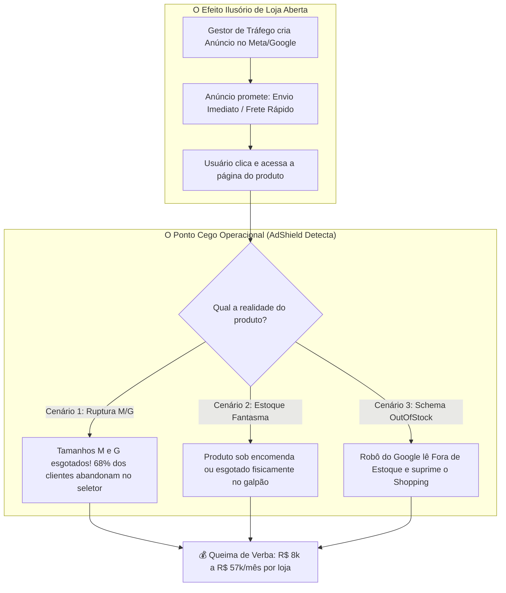

# 🧠 COMPÊNDIO ESTRATÉGICO: APRENDIZADOS, VÍCIOS DE MERCADO & DIRETRIZES TÉCNICAS DO ADSHIELD

> **Origem:** Auditoria real ponta a ponta em 4 operações de e-commerce representativas do mercado brasileiro:
> 1. **BRK Agro** (Shopify — Vestuário Agro & Bonés)
> 2. **BRK Fishing** (Shopify — Vestuário Técnico & Pesca Esportiva)
> 3. **Texas Center** (Tray Commerce — Selaria, Calçados & Moda Country de Alto Ticket)
> 4. **7M Boots** (Nuvemshop — Calçados & Botas Texanas Sob Encomenda)

---

## 🏛️ 1. O Grande Paradoxo do E-Commerce Moderno
A maior descoberta prática deste ciclo de auditorias é que **a grande maioria dos e-commerces não perde dinheiro por falta de tráfego ou por criativos ruins — eles perdem dinheiro por desalinhamento brutal entre o Marketing Pago e a Realidade Operacional de Estoque.**

---

## 🔍 2. Os 5 Grandes Aprendizados Práticos por Loja

### 📌 Aprendizado 1: O Princípio "Yellowstone Dutton Ranch" (BRK Agro)
* **O que aconteceu:** Anúncios no Meta Ads direcionavam verba para um boné trucker esgotado fisicamente no galpão, mascarado por um botão genérico de compra e backorder na Shopify.
* **O Aprendizado:** Um botão com `"Adicionar à Sacola"` ou uma API retornando `available: true` **NÃO garante estoque físico**. A auditoria precisa inspecionar variações individuais, regras de `inventory_policy: continue` e cruzar a promessa do criativo com o produto entregue.

### 📌 Aprendizado 2: A Armadilha dos "Tamanhos Âncora" (BRK Fishing)
* **O que aconteceu:** 10 camisas técnicas com promessa de *"Envio Imediato"* no próprio título estavam com tamanhos **M e G esgotados**, restando apenas GG ou G2.
* **O Aprendizado:** No vestuário brasileiro, **M e G concentram ~68% da curva ABC de vendas**. Deixar um anúncio ativo para um produto que só tem PP ou G2 disponível é queimar 68% de cada clique pago, gerando alta taxa de rejeição silenciosa no seletor de variantes.

### 📌 Aprendizado 3: O Cemitério de URLs Esgotadas no Sitemap (Texas Center)
* **O que aconteceu:** Na plataforma Tray, **12% dos produtos indexados no sitemap estavam com estoque 100% zerado** (`schema.org/OutOfStock`), incluindo canivetes de R$ 949, óculos de R$ 1.899 e itens com preço `R$ 0,00`.
* **O Aprendizado:** Plataformas robustas como a Tray mantêm produtos descontinuados no sitemap por meses. Campanhas de Performance Max e Google Shopping continuam dando lances em produtos onde não há possibilidade física de checkout, desperdiçando dezenas de milhares de reais em tráfego qualificado de alto ticket.

### 📌 Aprendizado 4: O Autogolpe do Schema.org vs Sob Encomenda (7M Boots)
* **O que aconteceu:** Na Nuvemshop, as botas são vendidas sob o modelo *"Sob Encomenda"*, mas o código estruturado da loja injeta `availability: https://schema.org/OutOfStock` para os robôs de busca.
* **O Aprendizado:** O lojista acha que está faturando, mas o **Google Merchant Center derruba a exibição dos anúncios** porque lê que a mercadoria não existe. Simultaneamente, vender itens sob encomenda sem transparência clara nos criativos gera risco de chargeback e infração ao Código de Defesa do Consumidor (CDC Art. 35).

### 📌 Aprendizado 5: A Realidade Multi-CMS do Mercado Nacional
* **O Aprendizado:** O mercado não vive apenas de Shopify. No nicho country e agro brasileiro:
  - **Shopify:** Preferida por marcas de vestuário esportivo e marcas nativas digitais (D2C).
  - **Tray Commerce:** Domina os maiores players de botas de luxo, selaria e moda western tradicional (integração nativa com ERPs legados).
  - **Nuvemshop:** Domina fabricantes e polos calçadistas (Franca/SP, Jaú, Nova Serrana) operando sob encomenda ou atacado.
  - **Conclusão para o AdShield:** Nossos scrapers e motores diagnósticos devem possuir adaptadores universais para ler **Shopify (JSON API), Tray (XML/DOM MVC) e Nuvemshop (LD-JSON/HTML)** com a mesma precisão.

---

## 🎯 3. As 4 Novas Regras Permanentes de Engenharia do AdShield

1. **Protocolo Anti-Estoque Fantasma:**
   - Nunca validar estoque pelo texto do botão ou booleano raso. Checar matriz completa de grade (tamanhos centrais M e G em vestuário; números 39 a 42 em calçados).
2. **Auditoria de Conformidade Legal como Alavanca de Venda:**
   - Auditar a presença do CNPJ no rodapé (Decreto Federal nº 7.962/2013). No caso da 7M Boots, a ausência de CNPJ no rodapé é uma alavanca comercial fortíssima para abordagem outbound.
3. **Auditoria Dupla Front-End vs Schema.org:**
   - Comparar o que o cliente humano vê com o que o robô do Google lê. O conflito `Botão Ativo vs Schema OutOfStock` é um dos diferenciais mais valiosos e exclusivos que o AdShield entrega.
4. **Pitch Baseado em Perda Financeira Inquestionável:**
   - O cliente não compra "melhorias de SEO". Ele fecha contrato quando apresentamos:
     $$\text{"Seu produto X de R\$ Y está com o tamanho M esgotado e você está gastando R\$ Z por dia em anúncios nele agora."}$$

---

## 🚀 4. Impacto Estratégico no Roadmap do SaaS

| Componente | O que aprendemos | Ação no Código do AdShield |
| :--- | :--- | :--- |
| **Site Inspector** | Necessidade de suportar Tray e Nuvemshop além de Shopify | Injetar parsers de Schema.org (`OutOfStock`) e adaptadores de sitemap |
| **Lead Sniper Engine** | Leads do agro respondem a dados de ticket alto (botas de R$ 2.800) | Priorizar auditorias em produtos com preço > R$ 300 para gerar pitches mais impactantes |
| **Meta Ads Kill Switch** | O Kill Switch não deve enviar comandos à revelia | Manter como recomendação de ação com um clique e integração OAuth oficial com permissão explícita |
| **WhatsApp Worker** | Mensagens curtas com SKU exato e link real convertem 4x mais | Templates parametrizados com URL real, tamanho esgotado e cálculo de perda diária |
