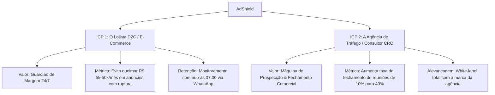
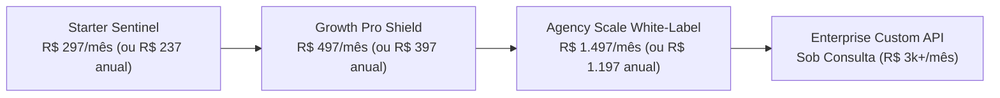
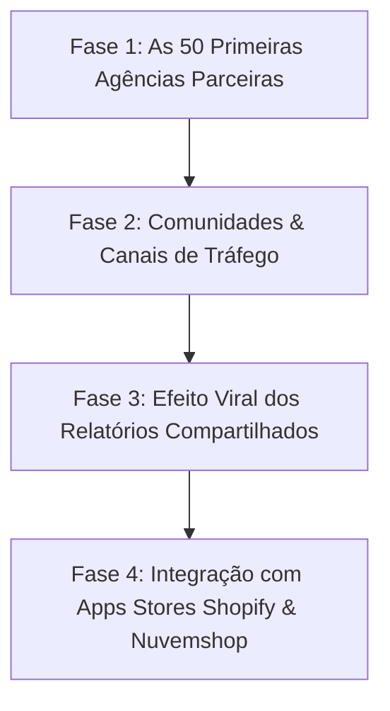

# 🚀 Plano de Negócios & Modelo de Monetização (Business Plan 2026-2027)
## AdShield SaaS (Ecossistema BRK Group)

> **Documento:** Master Business Plan & Go-To-Market Strategy  
> **Versão:** 3.0 (Orientada a Rentabilidade, Baixo Churn e Tração Dupla B2B)  
> **Tese Central:** O AdShield não é uma "ferramenta de diagnóstico esporádico". Ele é a **Infraestrutura Autônoma de Proteção de Margem para Lojistas e a Arma Definitiva de Fechamento Comercial para Agências**.

---

## 🏛️ 1. Sumário Executivo & Diagnóstico de Mercado

### 1.1 A Dor Real do E-Commerce Brasileiro
* O CAC (Custo de Aquisição de Clientes) no Meta Ads e Google Ads subiu mais de **38% nos últimos 24 meses** no Brasil devido à saturação do leilão e restrições de tracking.
* **O Paradoxo do Tráfego Pago:** Lojas investem de R$ 10.000 a R$ 200.000/mês em anúncios, mas perdem entre **18% a 32% dessa verba** direcionando tráfego qualificado para:
  1. Produtos com **grade quebrada** (tamanhos mais vendidos M, G, 40 e 41 esgotados).
  2. Páginas de produto lentas com imagens pesadas (>400KB) e sem tabela de medidas clara.
  3. Checkouts sem desconto Pix atraente ou com fricção de botões fora da zona de alcance do polegar.
* **O Paradoxo das Agências de Marketing:** Mais de 25.000 agências e gestores de tráfego no Brasil tentam prospectar lojistas com abordagens genéricas (*"Quer aumentar suas vendas?"*), obtendo taxa de conversão inferior a 1,5%.

---

## 🎯 2. Posicionamento Estratégico & Proposta de Valor Única (UVP)



---

## 👥 3. O Dual ICP (Os Dois Perfis de Clientes Ideais)

| Dimensão | ICP 1: Lojista / Head de E-Commerce | ICP 2: Agência de Performance / Consultor |
| :--- | :--- | :--- |
| **Perfil da Operação** | Faturamento de R$ 50k a R$ 1M/mês (Shopify, Nuvemshop, VTEX, Meli) | Agências com 5 a 50 clientes de tráfego pago e CRO |
| **Dor Principal** | ROAS em queda e sensação de que o tráfego não converte | Dificuldade de atrair clientes pagadores e provar valor na reunião |
| **Gatilho de Compra** | Descobrir que gastou dinheiro anunciando produto sem tamanho | Enviar um relatório executivo com a "prova do crime" em 60 segundos |
| **Produto Consumido** | Vigia de Ruptura 24h + Simulador de Pix + Tribunal de Consenso | Lead Sniper B2B + Dossiê White-Label em PDF + CRM de Leads |
| **LTV Esperado** | R$ 3.500 a R$ 7.000 (Retenção anual de monitoramento) | R$ 12.000 a R$ 30.000 (Software de infraestrutura da agência) |

---

## 💰 4. Modelo de Monetização & Tabela de Planos

Para neutralizar o risco de o lojista rodar uma auditoria e cancelar em 15 dias, o modelo de precificação é amarrado em **Monitoramento Diário Contínuo, Guardião 24/7 e Automação de Kill-Switch**.



### 4.1 Detalhamento dos Planos Oficiais

#### 🥉 Plano 1: STARTER SENTINEL (Lojista Solo / Fase de Tração) — **R$ 297 / mês** *(ou R$ 237/mês no anual)*
* **Foco:** Lojas faturando de R$ 15k a R$ 50k/mês que investem em tráfego pago.
* **Entregáveis:**
  - 1 Loja Virtual Monitorada 24/7.
  - Varredura diária de Rupturas de Grade PP ao G2.
  - Alerta Executivo diário via WhatsApp às 07:00 da manhã.
  - Simulador de Margem e Elasticidade no Pix vs Cartão.
  - Auditoria Core Web Vitals e contraste WCAG 2.1.
  - Suporte prioritário via WhatsApp.

#### 🥈 Plano 2: GROWTH PRO SHIELD (Lojas em Escala & D2C) — **R$ 497 / mês** *(ou R$ 397/mês no anual)* — **MAIS ESCOLHIDO / CARRO-CHEFE**
* **Foco:** E-commerces investindo acima de R$ 10.000/mês em tráfego pago (Meta Ads / Google Ads).
* **Entregáveis:**
  - Até 3 Lojas Virtuais Monitoradas 24/7.
  - **Auto-Kill Switch Meta Ads:** Pausa imediata de criativos promovendo variantes com estoque zerado no ERP/catálogo.
  - **Vigia WhatsApp 24/7 (07:00 da manhã):** Notificação detalhada para o time de tráfego antes da subida de lances.
  - Espião de Concorrentes & Benchmarking de Preço.
  - Gerador de Scripts Liquid & CSS Anti-Fuga (Tabela de Medidas e Thumb Zone).
  - Acesso à Torre de Controle do Enxame com 18 Agentes de IA.

#### 🥇 Plano 3: AGENCY SCALE WHITE-LABEL (Agências & Multi-Lojas) — **R$ 1.497 / mês** *(ou R$ 1.197/mês no anual)*
* **Foco:** Agências de performance que atendem carteiras de clientes e fecham contratos de gestão de CRO de R$ 3.000 a R$ 10.000/mês.
* **Entregáveis:**
  - **White-Label Total:** Logotipo, cores e domínio da agência nos relatórios e PDFs entregues ao lojista.
  - **Até 15 Lojas Virtuais Monitoradas** (Custo unitário < R$ 100/loja/mês).
  - **Motor Lead Sniper B2B:** Mineração de leads no Meta Ads Library para fechar novos clientes de tráfego.
  - CRM de Prospecção integrado com disparos assistidos com atraso humano anti-ban.
  - Webhooks customizados para Evolution API / Z-API e ERPs (Sankhya, Tiny, Bling).
  - Gerente de Sucesso de Conta dedicado e SLA de resposta em menos de 15 minutos.

#### 💎 Add-ons & Receitas Recorrentes Adicionais (Usage-Based)
1. **Pacote Extra de Leads Minerados (Lead Sniper):** R$ 197 para cada 500 leads enriquecidos adicionais.
2. **Monitoramento de Concorrente Adicional:** R$ 97/mês por concorrente espionado diariamente.
3. **Instalação Guiada em 1-Clique (One-Click Setup Service):** R$ 497 taxa única para implementação assistida por engenheiro no tema Shopify/Nuvemshop.

---

## 📈 5. Economia Unitária (Unit Economics) & Margem Bruta

| Indicador | Meta Ano 1 (2026) | Benchmark de Mercado SaaS | Observações de Eficiência |
| :--- | :--- | :--- | :--- |
| **Margem Bruta (Gross Margin)** | **88,5%** | 75% a 85% | Custo marginal de VPS + Proxies + Gemini Flash é ~R$ 0,08 por auditoria |
| **CAC Médio (ICP Lojista)** | R$ 260,00 | R$ 300 a R$ 600 | Aquisição via inbound orgânico e auditoria freemium |
| **CAC Médio (ICP Agência)** | R$ 750,00 | R$ 800 a R$ 1.500 | Aquisição via prospecção direta B2B e demonstrações ao vivo |
| **LTV Médio (Blended)** | R$ 5.960,00 | R$ 2.500 a R$ 4.000 | Ciclo médio de retenção de 10 a 14 meses |
| **Razão LTV / CAC** | **7.9x** | > 3.0x considerado excelente | Alavancagem saudável permitindo reinvestir em mídia |
| **Payback Period** | **1,5 meses** | < 6 meses | Retorno ultra-rápido do capital investido em aquisição |
| **Churn Mensal Alvo** | **< 2,8%** | 4% a 7% no B2B SMB | Blindado pela rotina diária do Vigia de WhatsApp e Kill-Switch |

---

## 🛡️ 6. A Estratégia Anti-Churn (Como Manter o Lojista Retido por Anos)

O maior erro de um SaaS de auditoria é entregar uma "foto estática". O AdShield é um **"filme contínuo"**:

1. **O Ritual Diário das 07:00 (WhatsApp Watchdog):**
   - Antes do gestor de tráfego ou do dono da loja abrir o computador, ele recebe no WhatsApp:
     > *"Bom dia, Carlos. O AdShield inspecionou sua loja às 06:45. Seu anúncio de Conjunto UV50+ Camuflado está ativo no Meta Ads, mas os tamanhos M e G acabaram no estoque ontem à noite. Pause a campanha ou abasteça a grade para não queimar verba hoje."*
   - O lojista **nunca cancela** um serviço que evita que ele perca R$ 1.000 no mesmo dia.
2. **Histórico de Evolução do Score (Timeline Contínua):**
   - O painel mostra a evolução: *"Em janeiro seu score era 58 (perda estimada de R$ 18k). Hoje seu score é 94 (lucro protegido de R$ 14.500)"*. O cliente vê visualmente o dinheiro que está no bolso dele graças ao sistema.
3. **A Tranca da Agência (Vendor Lock-in Positivo):**
   - A agência apresenta o relatório com a própria marca nas reuniões mensais de prestação de contas com os lojistas. O AdShield vira o **software oficial da reunião de diretoria da agência**.

---

## 🚀 7. Estratégia de Go-to-Market (Como Bater R$ 100k de MRR em 6 Meses)



### 7.1 Canal 1: Prospecção de Agências com o Próprio "Lead Sniper" (Dogfooding)
* **Como funciona:** Usamos o nosso próprio motor de prospecção para minerar 1.000 agências de marketing digital e gestores de tráfego no Brasil.
* **Abordagem de Alto Impacto:**
  > *"Olá, time da Agência X. Auditamos automaticamente 10 clientes de e-commerce da sua carteira pública. Detectamos que 4 deles estão com campanhas ativas para produtos com ruptura de estoque. Montamos este relatório em PDF de demonstração com a sua logo para você ver como fechar contratos de CRO cobrando R$ 3.000/mês a mais."*
* **Meta:** 50 agências pagando o plano de R$ 1.497/mês = **R$ 74.850,00 de MRR imediato**.

### 7.2 Canal 2: O Funil "Auditoria Gratuita de 60 Segundos" (Product-Led Growth)
* Uma barra de URL limpa e ultrarrápida na página inicial.
* O lojista digita a URL da própria loja e vê na hora:
  - O score real da vitrine.
  - A simulação paramétrica de perda financeira em anúncios.
  - O relatório das 3 maiores falhas de grade.
* **Para liberar o Dossiê Completo em PDF e o Vigia WhatsApp:** Ele cria a conta ou assina o plano.

### 7.3 Canal 3: Parcerias Estratégicas de Integração
* Parcerias com plataformas de checkout e ERPs (Sankhya, Bling, Tiny, Magis5, Yampi, Appmax).
* Apresentar o AdShield como o "auditor oficial de catálogo pré-leilão de anúncios".

---

## 🗺️ 8. Metas Financeiras e Projeção de Faturamento (DRE Projetado)

```
+---------------------------+-------------+-------------+-------------+
| Métrica                   | Mês 3       | Mês 6       | Mês 12      |
+---------------------------+-------------+-------------+-------------+
| Clientes Ativos Totais    | 60          | 180         | 520         |
| - Starter (R$ 297/mês)    | 25          | 70          | 180         |
| - Pro Shield (R$ 497/mês) | 25          | 80          | 260         |
| - Agency (R$ 1.497/mês)   | 10          | 30          | 80          |
| MRR (Receita Recorrente)  | R$ 34.820   | R$ 105.460  | R$ 302.440  |
| ARR (Anualizado)          | R$ 417.840  | R$ 1.265.520| R$ 3.629.280|
| Custos Operacionais (COGS)| R$ 2.200    | R$ 5.800    | R$ 14.200   |
| Impostos (Simples Nac. 6%)| R$ 2.089    | R$ 6.327    | R$ 18.146   |
| Lucro Bruto Operacional   | R$ 30.531   | R$ 93.333   | R$ 270.094  |
| Margem de Contribuição    | 87,7%       | 88,5%       | 89,3%       |
+---------------------------+-------------+-------------+-------------+
```

---

## ⚖️ 9. Conclusão e Diretrizes de Execução
1. **O Produto Já Está Pronto:** A infraestrutura de scraping, os 18 agentes, o redesign corporativo e a blindagem legal já estão em produção.
2. **A Batalha Agora é Distribuição:** O foco central da operação deve ser o **Dual-Funnel**: converter agências para o plano de R$ 997 e lojistas médios para o plano de R$ 497 ancorados no **Vigia WhatsApp 24/7**.
3. **Transparência como Vantagem Competitiva:** Ao contrário de ferramentas que prometem "mágica", nosso posicionamento é fundamentado em **dados auditados ao vivo, conformidade estrita com LGPD e simulações técnicas transparentes**.
