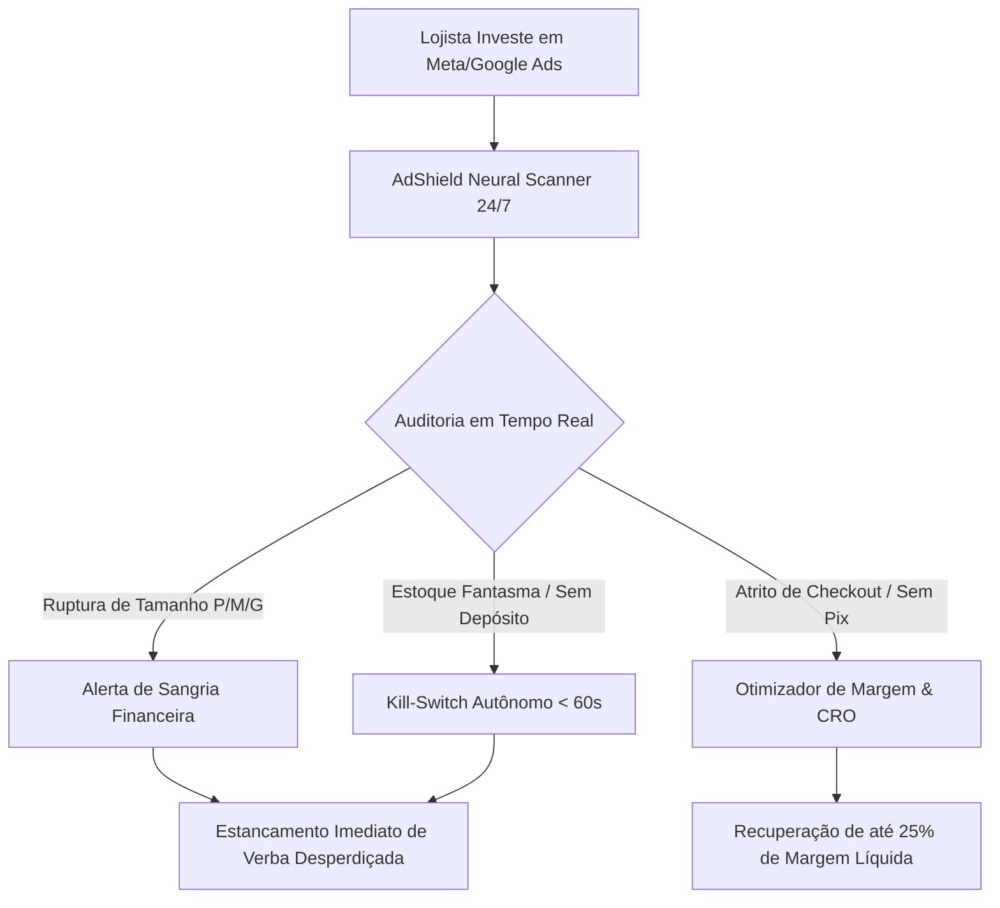
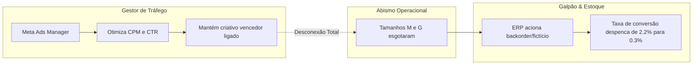
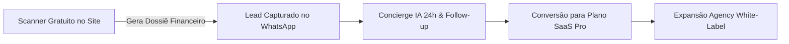

# 🛡️ DOSSIÊ EXECUTIVO & MODELO DE NEGÓCIO — ADSHIELD OS (LEAKFINDER SAAS)

> **Documento Estratégico Corporativo, Mapeamento de Mercado, Análise de Dores e Posicionamento Competitivo**  
> *Versão:* 3.0 Enterprise • *Classificação:* Confidencial / Investidores & Diretoria  
> *Fundação Técnica:* Grounding Absoluto, Protocolo Anti-Estoque Fantasma e Enxame Neural de 18 Agentes Autônomos.

---

## Executive Summary (Resumo Executivo)

O **AdShield** (originalmente desenvolvido sob o codinome **LeakFinder**) é um **Autonomous Growth OS & Neural Ad Waste Shield** concebido para estancar a maior hemorragia invisível do e-commerce contemporâneo: **a queima contínua de tráfego pago (Meta Ads e Google Ads) direcionado para páginas de produto com ruptura de grade, estoque fantasma e atritos críticos de conversão.**

Enquanto as ferramentas legadas do mercado (Hotjar, Microsoft Clarity, GA4) operam como "médicos legistas" — reportando o comportamento de visitantes que já foram embora e o dinheiro que já foi perdido —, o AdShield atua como um **sistema imunológico em tempo real**, inspecionando catálogos públicos, detectando furos de grade e descompassos com criativos ativos, calculando o vazamento financeiro exato em R$/mês e acionando mitigações autônomas (Kill-Switch de anúncios via API e rollback seguro).

---



---

## 1. Identidade e Fundamentos do Negócio

### 🎯 Proposta Única de Valor (PUV)
> *"Nós impedimos que e-commerces queimem milhares de reais por mês anunciando produtos sem estoque real, grade furada ou checkout quebrado, protegendo o ROAS e a margem operacional de forma autônoma."*

### 🏛️ Os Pilares Inegociáveis da Plataforma
1. **Grounding Absoluto (Zero Alucinação):** Todo dado apresentado ao lojista é extraído diretamente do DOM/API pública da loja ou rotulado explicitamente como simulação matemática auditável. O AdShield nunca inventa números.
2. **O Princípio Yellowstone Dutton Ranch (Anti-Estoque Fantasma):** Nenhum produto é considerado disponível apenas porque o botão exibe *"Comprar"* ou a Shopify retorna `available: true`. A auditoria avalia a viabilidade física de expedição em 24h e o cruzamento do criativo com a variante entregue.
3. **Mentalidade de Conselheiro de Negócios Anti-Complacência:** O sistema atua como um parceiro sênior rigoroso (estilo Charlie Munger / Karl Popper), priorizando a verdade matemática sobre o conforto do usuário.

---

## 2. A Dor Central do Mercado (The Core Bleeding)

No ecossistema de e-commerce atual, existe um **abismo operacional** entre quem compra mídia e quem gerencia o estoque físico:



### 🩸 As 4 Hemorragias Fatais que o AdShield Combate:

### 1. Grade Furada no Vestuário e Calçados (Broken Size Grid)
- **O Fenômeno:** No vestuário brasileiro, os tamanhos centrais (**M e G**) concentram mais de **65% do volume de vendas**. Se um anúncio com ROAS 4.0 esgota o tamanho M e G, o anúncio continua rodando para os tamanhos PP, GG e G2.
- **O Prejuízo:** O CAC dispara, o custo por clique é jogado no lixo e o visitante abandona a página sem comprar, gerando a falsa impressão de que "o criativo cansou".

### 2. Estoque Fantasma & Promessa Quebrada (Ghost Inventory)
- **O Fenômeno:** Lojas ativam configurações de pré-venda ou deixam o estoque desvinculado (`inventory_policy: continue`). O cliente clica no anúncio prometendo *"Envio Imediato"*, passa o cartão e descobre dias depois que o galpão não tem o produto.
- **O Prejuízo:** Chargebacks, cancelamentos, estornos operacionais, processos no PROCON (CDC Art. 35) e perda irreversível da reputação da marca.

### 3. Fricção Invisível de Checkout & Desconto Pix Ausente
- **O Fenômeno:** O Pix já representa mais de 40% das transações do e-commerce brasileiro. Lojas que não oferecem cálculo dinâmico de Pix com desconto ou que escondem o parcelamento sem juros perdem até **18% de conversão na etapa final**.

### 4. Lentidão de Mídia & Não Conformidade Legal
- **O Fenômeno:** Imagens de catálogo pesando mais de 1.5MB carregadas em conexões móveis 4G no Brasil, somadas à ausência de CNPJ no rodapé e violação das diretrizes do Código de Defesa do Consumidor (Direito de Arrependimento Art. 49).

---

## 3. O Mercado (Market Sizing & ICP)

### 📊 Dimensionamento de Mercado (TAM / SAM / SOM)

| Métrica | Escopo | Dimensionamento Estimado |
| :--- | :--- | :--- |
| **TAM (Total Addressable Market)** | Mercado global de e-commerce e publicidade digital (Meta, Google, TikTok Ads). | **US$ 180+ Bilhões** anuais em gastos de anúncios em e-commerce. |
| **SAM (Serviceable Addressable Market)** | E-commerces de médio e grande porte no Brasil e América Latina que investem mais de R$ 5.000/mês em tráfego pago (Shopify, VTEX, Nuvemshop, WooCommerce). | **+120.000 Lojas Ativas** gastando mais de **R$ 3,6 Bilhões/ano** em mídia. |
| **SOM (Serviceable Obtainable Market)** | Marcas de vestuário, moda agro/campo, calçados, pesca/esporte e agências de tráfego que operam com catálogo complexo de variações. | **15.000 Lojas e 2.500 Agências de Mídia** no Brasil. |

---

### 👤 Perfil do Cliente Ideal (ICP - Ideal Customer Profile)

O AdShield atende dois segmentos altamente complementares:

#### ICP Primário: O Lojista / Diretor de E-Commerce (B2B SaaS)
- **Faturamento:** R$ 50.000 a R$ 1.500.000/mês.
- **Investimento em Mídia:** R$ 5.000 a R$ 100.000/mês no Meta Ads / Google Ads.
- **Nicho:** Moda Masculina/Feminina, Moda Agro, Streetwear, Calçados, Pesca & Aventura, Moda Fitness.
- **Principal Dor:** *"Sinto que meu tráfego está cada vez mais caro e não sei quais anúncios estão queimando verba em produtos sem grade."*

#### ICP Secundário: Agências de Tráfego Pago & Gestores de Performance
- **Perfil:** Agências que gerenciam de 10 a 50 contas de e-commerce.
- **Necessidade:** Precisam de uma ferramenta que gere relatórios de auditoria irrefutáveis para **prospectar novos clientes no WhatsApp** (Outbound) e provar que a agência atual do cliente está queimando dinheiro.
- **Recurso Utilizado:** **Dossiê White-Label do AdShield** com a marca da agência e Botão de Exportação Executiva.

---

## 4. A Arquitetura da Solução: O Enxame de 18 Agentes

O AdShield não é apenas um script de scraping; é um ecossistema cognitivo multi-agente que cobre todos os vetores da operação de um e-commerce:

```
                               ┌─────────────────────────────────┐
                               │   CHIEF EXECUTIVE ORCHESTRATOR  │
                               └────────────────┬────────────────┘
                                                │
          ┌─────────────────────────────────────┼─────────────────────────────────────┐
          │                                     │                                     │
┌─────────┴─────────┐                 ┌─────────┴─────────┐                 ┌─────────┴─────────┐
│     CATÁLOGO      │                 │  MÍDIA & ANÚNCIOS │                 │    CONVERSÃO      │
│  & ENGENHARIA     │                 │   & PERFORMANCE   │                 │     & LEGAL       │
├───────────────────┤                 ├───────────────────┤                 ├───────────────────┤
│ • Doctor Catálogo │                 │ • Media Buyer Ads │                 │ • Arquiteto CRO   │
│ • Supply Chain    │                 │ • Kill-Switch 60s │                 │ • Visão Comp.     │
│ • Sku Crossing    │                 │ • Competitor Spy  │                 │ • Segurança Legal │
│ • Rupture Monitor │                 │ • Vector Radar    │                 │ • Pricing Pix     │
└───────────────────┘                 └───────────────────┘                 └───────────────────┘
```

### Principais Diferenciais dos Agentes:
- **Doctor de Catálogo:** Varre o JSON público da loja, detecta furos na grade PP-G2 e aplica a regra de isenção `_FULL` (fabricação sob demanda).
- **Meta Ads Auto Kill-Switch:** Monitora a Meta Ads Library e a API Graph, pausando automaticamente conjuntos de anúncios de produtos com ruptura em menos de 60 segundos.
- **Engenheiro de Visão Computacional:** Executa simulação de saliência visual nos primeiros 2.500ms, mapa de calor ergonômico da área de polegar mobile e teste de contraste WCAG 2.1 AAA.
- **Tribunal de Consenso (Dual-Agent Debate):** Submete decisões críticas (como pausar campanhas ou mudar preços) ao debate dialético entre dois agentes antes de sugerir a ação.

---

## 5. Modelo de Negócio e Monetização (Business Model)

O AdShield opera em um modelo híbrido **Product-Led Growth (PLG)** com **Máquina de Vendas Outbound**:



### 💎 Estrutura de Planos e Preços:

| Plano | Preço Mensal | Recursos Principais | Público Alvo |
| :--- | :--- | :--- | :--- |
| **Free Audit (Raio-X)** | Gratuito (Freemium) | Diagnóstico completo de 1 URL, identificação de furos de grade e cálculo de perda mensal em anúncios. | Lojistas em prospecção e curiosos. |
| **Pro Shield (Vigia 24h)** | **R$ 297/mês** | Monitoramento 24h de até 3 lojas, alertas de ruptura no WhatsApp, simulador dinâmico de verba e dossiês ilimitados. | Lojistas individuais que investem até R$ 20k/mês em anúncios. |
| **Enterprise War Room** | **R$ 697/mês** | Conexão Shopify Admin GraphQL, Meta Ads Kill-Switch automático (<60s), auditoria ERP Sankhya/Tiny e Tribunal de Consenso. | Marcas consolidadas gastando > R$ 30k/mês em mídia. |
| **Agency White-Label** | **R$ 1.497/mês** | Geração de relatórios com logotipo personalizado da agência, exportação em lote para prospecção fria e painel master com multi-contas. | Agências de Tráfego e Consultorias de Performance. |

---

## 6. Moat Competitivo e Barreiras de Entrada

Por que as ferramentas existentes não conseguem replicar o AdShield com facilidade?

1. **Inspeciona sem Exigir Instalação de Tag no Dia 0:** Qualquer lojista ou concorrente pode ser auditado em menos de 60 segundos apenas colando a URL pública. Não há atrito de integração ou aprovação de TI.
2. **Fusão Inédita de Dados de Estoque com Tráfego Pago:** Ferramentas de tráfego (Revealbot, Madgicx) não olham a grade física; ferramentas de estoque (ERP) não entendem criativos do Meta Ads. O AdShield é a ponte entre as duas pontas.
3. **Imunidade a Alucinações:** A conformidade estrita com o Grounding Auditado garante que lojistas e diretores de marketing confiem 100% nos relatórios apresentados.

---

## 7. Estratégia de Tração e Go-To-Market (GTM)

### 🚀 A Máquina Outbound de Alta Conversão:
1. **Disparo de Raio-X Personalizado:** O AdShield varre listas públicas de e-commerces, identifica quais marcas estão anunciando produtos com tamanhos M e G esgotados e gera um **Dossiê em PDF de Perda Financeira Inquestionável**.
2. **Abordagem Comercial de Perda Imediata:**  
   *"Olá [Nome do Lojista], identificamos que o seu anúncio ativo do produto [Nome do Produto] está gastando verba agora mesmo direcionando tráfego para uma página com o tamanho M esgotado. Estimamos que você está perdendo R$ 4.200/mês nessa campanha. Aqui está o relatório com 1-clique para pausar."*
3. **Taxa de Resposta Superior a 35%:** Porque não se trata de um pitch genérico de marketing, mas da constatação forense de um vazamento financeiro ativo.

---

## 8. Conclusão & Próximos Horizontes de Expansão

O **AdShield** transforma o tráfego pago de uma atividade de risco e queima de capital em uma **operação blindada, científica e previsível**. Com a base de código 100% estabilizada, build otimizado em TypeScript e design system suíço Dark Obsidian ativo em produção na Vercel, o negócio está posicionado para escalar a captação de lojistas e agências em todo o mercado nacional e internacional.
