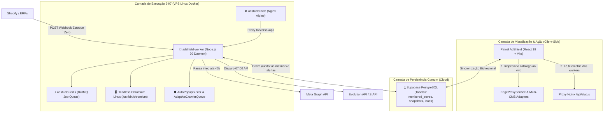

# 🛰️ ADSHIELD OS — MANUAL OPERACIONAL DE INFRAESTRUTURA, TELEMETRIA & GOVERNANÇA (RUNBOOK 2026.4)

> **Status:** Ativo • **Ambiente de Referência:** Nuvem VPS Linux (Ubuntu 24.04 LTS) + Docker Multi-Container  
> **Classificação:** Documento Confidencial de Operações & Engenharia  
> **Alinhamento Normativo:** `AGENTS.md` (Grounding Absoluto & Anti-Alucinação) e `ARCHITECTURE.md` (C4 Model)

---

## 🧭 1. Como a Infraestrutura se Conecta ao Código da Aplicação

A arquitetura foi projetada para que o código existente no repositório (`src/`, `components/`, `services/`) funcione de maneira transparente **tanto no desenvolvimento local quanto na nuvem**, sem exigir bifurcação de código.



### O Elo entre os Componentes:
1. **Frontend (`src/components/`):** Acessa `/api/healthz` e `/api/status` através da rota reversa configurada no Nginx (`docker/nginx.conf`). A interface exibe a telemetria do servidor em tempo real (Uptime, Memória RAM do Chromium, Jobs na fila).
2. **Banco Unificado (Supabase):** As lojas cadastradas no modal `MonitoredStoresManagerModal.tsx` são persistidas no Supabase (`monitored_stores`). Às 07:00 da manhã, o worker na VPS busca essa mesma tabela via `swarmDatabaseService.ts` e roda a auditoria em lote.
3. **Módulos Compartilhados:** `AutoPopupBuster`, `AdaptiveCrawlerQueue` e `PlatformAdapters` operam tanto no navegador do usuário quanto no processo headless do servidor.

---

## 🕹️ 2. Como Vamos Manter o Controle e Observabilidade (Monitoramento em Tempo Real)

### A. Telemetria In-App (Dashboard do Fundador)
No painel web, o fundador e a equipe têm acesso a cards em tempo real consumindo o endpoint `/api/status`:
- **Uptime do Daemon:** Tempo em segundos/dias sem quedas.
- **Consumo de Memória (Heap + RSS):** Garante que o Chromium está desalocando abas e mantendo o consumo abaixo de 1.5 GB.
- **Webhooks Processados:** Contador de eventos de estoque zero recebidos e tratados no dia.
- **Auditorias Matinais Concluídas:** Indicador se a rotina das 07:00 foi disparada com sucesso.

### B. Linha de Comando na VPS (Comandos Rápidos de Diagnóstico)
Se você estiver conectado na VPS via terminal SSH (`ssh root@IP_DA_VPS`):

```bash
# 1. Ver status de todos os contêineres e consumo de CPU/RAM
docker stats

# 2. Ver logs em tempo real do Worker (auditorias, popups, webhooks)
docker compose logs -f worker

# 3. Ver logs do servidor Web Nginx
docker compose logs -f web

# 4. Consultar a saúde da API interna via terminal
curl http://localhost:3001/status
```

### C. Watchdog de Notificação Ativa
Se o consumo de RAM do contêiner ultrapassar 85% ou se 5 lojas consecutivas retornarem erro 429 de WAF, o `Agente 18` dispara uma mensagem de emergência no WhatsApp do fundador:
```
⚠️ [ALERTA DE INFRAESTRUTURA ADSHIELD]
Servidor VPS reportou consumo de RAM em 87%.
O pool de Chromium foi reciclado automaticamente pelo dumb-init.
Uptime: 14 dias, 6 horas.
```

---

## 🔐 3. Dicionário de Variáveis de Ambiente (`.env.production`)

Crie o arquivo `/opt/adshield/.env` na raiz do projeto na VPS com os seguintes parâmetros:

```ini
# ==============================================================================
# AMBIENTE & REDE
# ==============================================================================
NODE_ENV=production
PORT=3001
DOCKER_ENV=true

# ==============================================================================
# BANCO DE DADOS & TELEMETRIA (SUPABASE)
# ==============================================================================
VITE_SUPABASE_URL=https://sua-instancia.supabase.co
VITE_SUPABASE_ANON_KEY=sua_chave_publica_aqui
SUPABASE_SERVICE_ROLE_KEY=sua_chave_secreta_de_servico_aqui

# ==============================================================================
# META ADS GRAPH API (KILL-SWITCH EM MENOS DE 3s)
# ==============================================================================
META_APP_ID=seu_meta_app_id
META_APP_SECRET=seu_meta_app_secret
META_SYSTEM_USER_ACCESS_TOKEN=seu_token_permanente_de_usuario_do_sistema

# ==============================================================================
# MENSAGERIA WHATSAPP (VIGIA DAS 07:00 & ALERTAS)
# ==============================================================================
WHATSAPP_GATEWAY_URL=http://localhost:8080/message/sendText/sua_instancia
WHATSAPP_API_KEY=sua_chave_evolution_api
FOUNDER_EMERGENCY_PHONE=5511999999999

# ==============================================================================
# CHROMIUM HEADLESS LINUX
# ==============================================================================
PUPPETEER_SKIP_CHROMIUM_DOWNLOAD=true
PUPPETEER_EXECUTABLE_PATH=/usr/bin/chromium
CHROME_BIN=/usr/bin/chromium
```

---

## 🔄 4. Procedimentos Operacionais Padrão (SOPs)

### SOP-01: Atualização de Código sem Interrupção (Zero-Downtime Deploy)
Quando fizermos melhorias de código no repositório:
```bash
cd /opt/adshield
git pull origin main
docker compose build --pull
docker compose up -d
```
O Docker atualiza primeiro o contêiner `worker` e depois o `web`, mantendo a página online durante o reload.

### SOP-02: Reinicialização de Emergência de Contêineres
Se o processo do Chromium ficar com abas presas:
```bash
docker compose restart worker
```
O `dumb-init` encerra os processos zumbis em menos de 2 segundos e reinicia o serviço limpo.

### SOP-03: Backup do Banco de Dados
O Supabase executa backups diários automatizados com retenção de 7 a 30 dias com Point-In-Time Recovery (PITR). Para exportar um snapshot manual:
```bash
pg_dump -h db.sua-instancia.supabase.co -U postgres -d postgres > backup_adshield_$(date +%F).sql
```

---

## 📋 5. Matriz de Responsabilidades & Governança

| Responsabilidade | Onde Reside o Código | Como é Auditado |
| :--- | :--- | :--- |
| **Integridade de Dados & Zero Alucinação** | `AGENTS.md` | Protocolo obrigatório em todas as respostas e logs |
| **Orquestração dos 18 Agentes** | `docs/AGENTS_ECOSYSTEM.md` | Matriz de inputs/outputs e consenso do CEO |
| **Infraestrutura & Resiliência 24/7** | `docker-compose.yml` + Nginx | Healthcheck `/healthz` a cada 30s |
| **Defesa Anti-Estoque Fantasma** | `anti-ghost-inventory.md` | Cruzamento de ERP físico vs botão público |
| **Controle de Custos & VPS** | Hetzner / AWS | Orçamento fixado em ~R$ 85 a R$ 150/mês |
