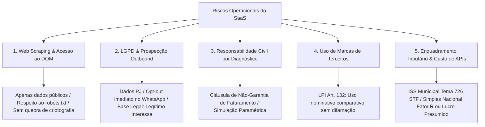

# ⚖️ Dossiê de Governança Jurídica, Regulatória, LGPD e Tributação
## AdShield OS (Ecossistema BRK Group)

> **Data de Elaboração:** Setembro de 2026  
> **Status:** Parecer Estratégico & Matriz de Mitigação de Riscos Regulatórios  
> **Objetivo:** Estabelecer as salvaguardas legais inquebráveis, a estrutura tributária otimizada e os limites de responsabilidade civil para operação em escala nacional e internacional.

---

## 🏛️ 1. Matriz de Riscos Jurídicos (Onde o SaaS Pode Quebrar e Como Blindar)

---

## 🔍 2. Raspagem de Dados (Web Scraping) & Marco Civil da Internet (Lei 12.965/2014)

### 2.1 A Legalidade da Raspagem Pública no Brasil
* **Regra Fundamental:** Raspagem de dados **abertos e públicos** na web não é crime no Brasil, desde que:
  1. **Não viole barreiras de autenticação/segurança privada** (Art. 154-A do Código Penal — Invasão de dispositivo informático). O AdShield inspeciona o HTML aberto e o `/products.json` público; ele não quebra logins restritos.
  2. **Não caracterize Ataque de Negação de Serviço (DDoS Culposo):** Requisições em loop violento que derrubem o servidor da loja podem gerar ação de indenização por perdas e danos e lucros cessantes (Código Civil, Art. 186 e 927).
  3. **Marco Civil da Internet (Art. 3º, VI):** A disciplina do uso da internet no Brasil tem como princípio a finalidade social da rede e a liberdade dos modelos de negócios.

### 2.2 Blindagens Técnicas Mandatórias
* **Taxa de Requisição Controlada (Rate Limiting):** Headers de requisição devem simular tráfego civilizado com intervalos de no mínimo 250ms a 500ms entre requisições em uma mesma loja.
* **User-Agent Transparente:** Identificar o bot como ferramenta de auditoria de conformidade técnica, com link para contato e desativação caso o webmaster solicite (`User-Agent: AdShieldBot/2.0 (+https://adshield.ai/bot)`).

---

## 🛡️ 3. LGPD (Lei 13.709/2018) & Prospecção Ativa (WhatsApp Outbound)

### 3.1 Dados PJ vs. Dados de Pessoa Natural
* **O Art. 5º, I da LGPD é categórico:** Dado pessoal é a *"informação relacionada a pessoa natural identificada ou identificável"*.
* **Catálogo, Preços, SKUs, CNPJ, Razão Social e Endereço Comercial:** São dados de **Pessoas Jurídicas**. **NÃO estão sob a proteção da LGPD.**
* **O Ponto Crítico (MEI e Empresas Individuais):**
  - No caso de e-commerces geridos por MEI ou empresários individuais, o e-mail de contato e o número de WhatsApp no rodapé muitas vezes coincidem com o telefone pessoal do sócio.
  - A ANPD (Autoridade Nacional de Proteção de Dados) interpreta que dados publicizados no rodapé de uma loja aberta ao público para fins de contato comercial foram **manifestamente tornados públicos pelo titular (Art. 7º, § 4º da LGPD)**.

### 3.2 O Uso do WhatsApp no Módulo de Prospecção (Lead Sniper / Vigia WhatsApp)
* **Base Legal:** **Legítimo Interesse (Art. 7º, IX da LGPD)** combinado com dados tornados públicos para fins comerciais.
* **Obrigações Inegociáveis no Primeiro Contato:**
  1. **Transparência de Origem:** Informar de onde o dado foi extraído (*"Encontrei seu contato no rodapé público da sua loja..."*).
  2. **Direito de Opt-Out Imediato e Gratuito:** O lojista deve ter a opção clara: *"Se não deseja mais receber relatórios de auditoria da sua loja, responda PARAR"*.
  3. **Lista de Exclusão Permanente (Blacklist):** Se responder "PARAR", o número deve ser incluído na tabela de bloqueio e **NUNCA MAIS** ser contatado pelo sistema.
* **Risco de Banimento pela Meta (WhatsApp Business):**
  - O disparo automatizado em massa fere os Termos de Serviço da Meta. A abordagem deve ser **assistida (human-in-the-loop)** ou via **API Oficial do WhatsApp Business (WABA / Cloud API)**, nunca via instâncias clandestinas que causem o banimento do número institucional.

---

## 💰 4. Enquadramento Tributário & Fiscal no Brasil (SaaS)

### 4.1 Incidência Tributária: ISS vs. ICMS (Tema 726 do STF)
* O Supremo Tribunal Federal (ADI 5659 e ADI 5958) pacificou que o licenciamento ou cessão de direito de uso de programas de computador em nuvem (SaaS) é **fato gerador de ISS (Imposto Sobre Serviços de Qualquer Natureza)**, de competência municipal, afastando em definitivo o ICMS estadual.
* **Alíquota de ISS:** Varia de **2% a 5%**, conforme o município da sede da empresa (ex: São Paulo é 2,9% para desenvolvimento de software, Uberlândia/BH é 2% a 3%).

### 4.2 Classificação Nacional de Atividades Econômicas (CNAE Recomendado)
1. **CNAE Principal:** `6311-9/00` — Tratamento de dados, provedores de serviços de aplicação e serviços de hospedagem na internet (Hospedagem e SaaS).
2. **CNAE Secundário 1:** `6203-1/00` — Desenvolvimento e licenciamento de programas de computador não-customizáveis.
3. **CNAE Secundário 2:** `7319-0/04` — Consultoria em publicidade e pesquisa de mercado (relevante para os módulos de análise de mídia e tráfego pago).

### 4.3 Regime Tributário Ideal (Evolução de Faturamento)
* **Fase 1: Simples Nacional (Faturamento até R$ 4,8 milhões/ano)**
  - O SaaS por padrão cai no **Anexo V** (alíquotas a partir de 15,5%).
  - **A Estratégia do "Fator R" (Art. 18, § 5º-J da LC 123/2006):** Se a folha de pagamento (incluindo o pró-labore dos sócios) for igual ou superior a **28% da receita bruta**, o SaaS é tributado no **Anexo III** (alíquota inicial reduzida para **6%**!).
* **Fase 2: Lucro Presumido (Faturamento acima do limite do Simples ou para otimização de deduções)**
  - Alíquotas Federais Fixas: IRPJ (15% + adicional de 10% s/ excedente de R$ 20k/mês) e CSLL (9%) sobre presunção de 32% da receita de serviços = ~4,8% + 2,88%.
  - PIS (0,65%) e COFINS (3%).
  - ISS Municipal: 2% a 5%.
  - **Carga Tributária Total no Lucro Presumido:** **13,33% a 16,33%** sobre a receita faturada.

### 4.4 Importação de Serviços de Tecnologia (Vercel, Supabase, Google Cloud, APIs LLM)
* Pagamentos de servidores e APIs hospedados no exterior com cartão corporativo sofrem retenção/incidência tributária:
  - **IOF:** 4,38% (em redução gradual conforme Decreto 11.153/2022 até zerar em 2028).
  - **IRRF (Imposto de Renda Retido na Fonte):** 15% (ou 25% para paraísos fiscais).
  - **CIDE-Royalties / CIDE-Serviços:** 10%.
  - **PIS/COFINS-Importação:** 9,25%.
* *Atenção Contábil:* Contratar através de subsidiárias ou entidades consolidadas no Brasil com faturamento local (ex: Google Cloud Brasil LTDA com NF-e local) elimina essas bitributações internacionais.

---

## 📑 5. Código de Defesa do Consumidor (CDC) & Limitação de Responsabilidade

### 5.1 O AdShield é B2B, mas o CDC Pode Ser Aplicado?
* **A Regra Geral:** Entre empresas (B2B), vigora o Código Civil e a liberdade contratual.
* **A Exceção Perigosa (Teoria Finalista Mitigada do STJ):** Quando o cliente do SaaS é um microempreendedor individual (MEI) ou um pequeno lojista que não possui conhecimento técnico sobre código ou tráfego pago, o Judiciário brasileiro costuma considerá-lo **vulnerável**, aplicando as regras protetivas do Código de Defesa do Consumidor (Lei 8.078/1990).

### 5.2 O Perigo das Afirmações de "Perda Financeira"
* Se o sistema afirmar sem ressalvas: *"Sua loja está perdendo exatamente R$ 42.800,00 por mês porque falta o tamanho M"* e o lojista tomar a decisão de demitir seu gestor de tráfego, comprar R$ 50.000 em estoque e não vender, ele pode acionar o SaaS por **Dano Material e Propaganda Enganosa (CDC, Art. 37)**.
* **A Salvaguarda Obrigatória nos Termos de Uso e nas Telas:**
  > *"Todo e qualquer valor monetário indicado nesta plataforma possui caráter estritamente estimativo e paramétrico, obtido a partir de modelos matemáticos e benchmarks médios do comércio eletrônico. O AdShield não garante rentabilidade, faturamento ou resultados futuros. As decisões operacionais e financeiras são de exclusiva responsabilidade do lojista contratante."*

### 5.3 Direito de Arrependimento de 7 Dias (CDC, Art. 49)
* Qualquer compra realizada pela internet possui garantia incondicional de reembolso integral em até 7 dias corridos a partir da assinatura. O sistema deve prever cancelamento self-service com 1 clique.

---

## 🏷️ 6. Uso de Marcas e Concorrência Desleal (Lei 9.279/1996 - LPI)

### 6.1 Módulo de Espionagem & Comparativo de Concorrentes
* O AdShield permite comparar a loja com grandes players do mercado (ex: Insider Store, Baw Clothing, Reserva, Nike).
* **O que Diz a Lei de Propriedade Industrial (Art. 132, IV da LPI):** O titular da marca não pode impedir a citação da marca em discurso, crítica, notícia ou comparativo legítimo de mercado, **desde que não haja o intuito de causar confusão de procedência nem denegrimento da marca.**
* **Diretriz de Posicionamento:**
  - NUNCA dizer: *"A loja X pratica fraude"* ou *"O concorrente mente na proteção UV"*.
  - SEMPRE apresentar fatos técnicos auditados: *"O concorrente X utiliza grade de 8 tamanhos e carrega a página em 1.2s via CDN Cloudflare"*.
  - Substituir termos de conotação agressiva (*"Espião", "Prova do Crime"*) por termos corporativos periciáveis (*"Inteligência Competitiva", "Benchmarking de Mercado"*).

---

## 📋 7. Plano de Ação & Checklist de Conformidade Jurídica Imediata

| Item | Ação Necessária | Status / Prioridade |
| :--- | :--- | :--- |
| **Termos de Uso** | Inserir cláusula de limitação de responsabilidade e simulações paramétricas | 🟢 Pronto em `/terms` |
| **Política de Privacidade** | Cadastrar e-mail oficial do DPO e procedimentos de remoção (LGPD) | 🟢 Pronto em `/privacy` |
| **Blacklist no WhatsApp** | Implementar tabela de números com opt-out permanente no banco de dados | 🟡 Alta Prioridade |
| **CNPJ no Rodapé** | Inserir a Razão Social completa e CNPJ da operadora no rodapé de todas as páginas | 🟡 Obrigatório (Decreto 7.962/13) |
| **Nota Fiscal Eletrônica (NFS-e)** | Integrar gateway de pagamento (Stripe/Asaas) com emissão automática de NFS-e | 🔴 Crítico para início de cobrança |
| **Enquadramento no Simples** | Otimizar folha e pró-labore para enquadrar no Anexo III via Fator R (6%) | 🟡 Alinhamento com Contador |
