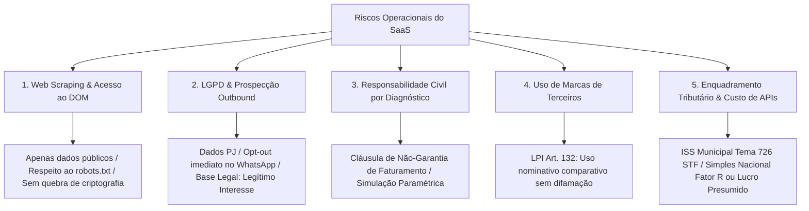

# ⚖️ Dossiê de Governança Jurídica, Regulatória, LGPD e Tributação
## AdShield OS (Ecossistema BRK Group)

> **Data de Elaboração:** Setembro de 2026 • **Versão:** 3.5 Enterprise  
> **Status:** Parecer Estratégico, Matriz de Mitigação de Riscos Regulatórios & Legal Defense Kit  
> **Objetivo:** Estabelecer as salvaguardas legais inquebráveis, a estrutura tributária otimizada e os limites de responsabilidade civil para operação em escala nacional e internacional.

---

## 🏛️ 1. Matriz de Riscos Jurídicos (Onde o SaaS Pode Quebrar e Como Blindar)



---

## 🔍 2. Raspagem de Dados (Web Scraping) & Marco Civil da Internet (Lei 12.965/2014)

### 2.1 A Legalidade da Raspagem Pública no Brasil
* **Regra Fundamental:** Raspagem de dados **abertos e públicos** na web não é crime no Brasil, desde que:
  1. **Não viole barreiras de autenticação/segurança privada** (Art. 154-A do Código Penal — Invasão de dispositivo informático). O AdShield inspeciona o HTML aberto e o `/products.json` público; ele não quebra logins restritos nem transpassa firewalls.
  2. **Não caracterize Ataque de Negação de Serviço (DDoS Culposo):** Requisições em loop violento que derrubem o servidor da loja podem gerar ação de indenização por perdas e danos e lucros cessantes (Código Civil, Art. 186 e 927).
  3. **Marco Civil da Internet (Art. 3º, VI):** A disciplina do uso da internet no Brasil tem como princípio a finalidade social da rede e a liberdade dos modelos de negócios.
  4. **Jurisprudência dos Tribunais Superiores (STJ - REsp nº 1.956.126/SP):** O Superior Tribunal de Justiça reconhece a licitude da coleta de dados publicamente disponíveis para fins de agregação de valor mercadológico e inteligência analítica, desde que preservada a estabilidade do servidor de origem.

### 2.2 Blindagens Técnicas Mandatórias
* **Taxa de Requisição Controlada (Rate Limiting):** Headers de requisição devem simular tráfego civilizado com intervalos de no mínimo 250ms a 500ms entre requisições em uma mesma loja.
* **User-Agent Transparente:** Identificar o bot como ferramenta de auditoria de conformidade técnica, com link para contato e desativação caso o webmaster solicite (`User-Agent: AdShieldBot/2.0 (+https://adshield.ai/bot)`).

---

## 🛡️ 3. LGPD (Lei 13.709/2018) & Prospecção Ativa (WhatsApp Outbound)

### 3.1 Dados PJ vs. Dados de Pessoa Natural
* **O Art. 5º, I da LGPD é categórico:** Dado pessoal é a *"informação relacionada a pessoa natural identificada ou identificável"*.
* **Catálogo, Preços, SKUs, CNPJ, Razão Social e Endereço Comercial:** São dados de **Pessoas Jurídicas**. **NÃO estão sob a proteção da LGPD.**
* **O Ponto Crítico (MEI e Empresas Individuais):**
  - No caso de e-commerces geridos por MEI ou empresários individuais, o e-mail de contato e o número de WhatsApp no rodapé muitas vezes coincidem com o telefone pessoal do sócio.
  - A ANPD (Autoridade Nacional de Proteção de Dados) interpreta que dados publicizados no rodapé de uma loja aberta ao público para fins de contato comercial foram **manifestamente tornados públicos pelo titular (Art. 7º, § 4º da LGPD)**.

### 3.2 O Uso do WhatsApp no Módulo de Prospecção (Lead Sniper / Vigia WhatsApp)
* **Bases Legais Cumulativas:**
  1. **Art. 7º, § 4º da LGPD:** Dados tornados manifestamente públicos pelo próprio titular para fins de atendimento e vendas.
  2. **Art. 7º, IX c/c Art. 10 da LGPD:** **Legítimo Interesse** do controlador e do próprio titular em evitar desperdício de verba publicitária e perdas operacionais decorrentes de anúncios para produtos sem estoque.
* **Obrigações Inegociáveis no Primeiro Contato:**
  1. **Transparência de Origem:** Informar de onde o dado foi extraído (*"Inspecionamos os canais públicos da sua loja virtual..."*).
  2. **Direito de Opt-Out Imediato e Gratuito:** O lojista deve ter a opção clara: *"Se não deseja mais receber laudos técnicos da sua loja, responda PARAR"*.
  3. **Lista de Exclusão Permanente (Blacklist):** Se responder "PARAR" ou "SAIR", o número é incluído na tabela de bloqueio e **NUNCA MAIS** é contatado pelo sistema.
* **Risco de Banimento pela Meta (WhatsApp Business):**
  - O disparo automatizado em massa fere os Termos de Serviço da Meta. A abordagem deve ser **assistida (human-in-the-loop)** via link `https://wa.me/` com clique manual do gestor, ou via **API Oficial do WhatsApp Business (WABA / Cloud API)** com templates homologados pela Meta.

---

## 💰 4. Enquadramento Tributário & Fiscal no Brasil (SaaS)

### 4.1 Incidência Tributária: ISS vs. ICMS (Tema 726 do STF)
* O Supremo Tribunal Federal (ADI 5659 e ADI 5958) pacificou que o licenciamento ou cessão de direito de uso de programas de computador em nuvem (SaaS) é **fato gerador de ISS (Imposto Sobre Serviços de Qualquer Natureza)**, de competência municipal, afastando em definitivo o ICMS estadual.
* **Alíquota de ISS:** Varia de **2% a 5%**, conforme o município da sede da empresa (Minas Gerais: 2% a 3%).

### 4.2 Classificação Nacional de Atividades Econômicas (CNAE Recomendado)
1. **CNAE Principal:** `6311-9/00` — Tratamento de dados, provedores de serviços de aplicação e serviços de hospedagem na internet (Hospedagem e SaaS).
2. **CNAE Secundário 1:** `6203-1/00` — Desenvolvimento e licenciamento de programas de computador não-customizáveis.
3. **CNAE Secundário 2:** `7319-0/04` — Consultoria em publicidade e pesquisa de mercado (análise de mídia e tráfego pago).

### 4.3 Regime Tributário Ideal (Evolução de Faturamento)
* **Fase 1: Simples Nacional (Faturamento até R$ 4,8 milhões/ano)**
  - O SaaS por padrão cai no **Anexo V** (alíquotas a partir de 15,5%).
  - **A Estratégia do "Fator R" (Art. 18, § 5º-J da LC 123/2006):** Se a folha de pagamento (incluindo o pró-labore dos sócios) for igual ou superior a **28% da receita bruta**, o SaaS é tributado no **Anexo III** (alíquota inicial reduzida para **6%**!).
* **Fase 2: Lucro Presumido (Faturamento acima do limite do Simples ou para otimização de deduções)**
  - Alíquotas Federais Fixas: IRPJ (15% + adicional de 10% s/ excedente de R$ 20k/mês) e CSLL (9%) sobre presunção de 32% da receita de serviços = ~4,8% + 2,88%.
  - PIS (0,65%) e COFINS (3%).
  - ISS Municipal: 2% a 5%.
  - **Carga Tributária Total no Lucro Presumido:** **13,33% a 16,33%** sobre a receita faturada.

---

## 📑 5. Código de Defesa do Consumidor (CDC) & Limitação de Responsabilidade

### 5.1 O AdShield é B2B, mas o CDC Pode Ser Aplicado?
* **A Regra Geral:** Entre empresas (B2B), vigora o Código Civil e a presunção de paridade e simetria contratual (Arts. 421 e 421-A do Código Civil, com redação da Lei de Liberdade Econômica nº 13.874/2019).
* **A Exceção (Teoria Finalista Mitigada do STJ):** Quando o cliente do SaaS é um microempreendedor individual (MEI) vulnerável tecnicamente, o Judiciário pode aplicar subsidiariamente o CDC. Por precaução, o SaaS já nasce 100% aderente ao CDC.

### 5.2 O Perigo das Afirmações de "Perda Financeira" & A Salvaguarda Paramétrica
* **A Salvaguarda Obrigatória nos Termos de Uso e nas Telas:**
  > *"Todo e qualquer valor monetário indicado nesta plataforma possui caráter estritamente estimativo e paramétrico, obtido a partir de modelos matemáticos e benchmarks médios do comércio eletrônico. O AdShield não garante rentabilidade, faturamento ou resultados futuros. As decisões operacionais e financeiras são de exclusiva responsabilidade do lojista contratante."*

### 5.3 Direito de Arrependimento de 7 Dias (CDC, Art. 49)
* Qualquer compra realizada pela internet possui garantia incondicional de reembolso integral em até 7 dias corridos a partir da assinatura. O sistema prevê cancelamento self-service e reembolso sem atrito.

---

## 🏷️ 6. Uso de Marcas e Concorrência Desleal (Lei 9.279/1996 - LPI)

### 6.1 Módulo de Espionagem & Comparativo de Concorrentes
* O AdShield permite comparar a loja com grandes players do mercado.
* **O que Diz a Lei de Propriedade Industrial (Art. 132, IV da LPI):** O titular da marca não pode impedir a citação da marca em discurso, crítica, notícia ou comparativo legítimo de mercado, **desde que não haja o intuito de causar confusão de procedência nem denegrimento da marca.**
* **Diretriz de Posicionamento:**
  - NUNCA dizer: *"A loja X pratica fraude"* ou *"O concorrente mente"*.
  - SEMPRE apresentar fatos técnicos auditados: *"O concorrente X utiliza grade de 8 tamanhos e carrega a página em 1.2s via CDN"*.
  - Vocabulário neutro e pericial: *"Inteligência Competitiva", "Benchmarking de Mercado", "Auditoria de Conformidade"*.

---

## 🛡️ 7. Minuta Pronta de Contra-Notificação Extrajudicial (Legal Defense Kit)

Caso algum lojista ou escritório de advocacia envie notificação extrajudicial questionando a auditoria da loja ou o envio de mensagem via WhatsApp, a resposta pré-formatada do departamento jurídico é:

```markdown
ILUSTRÍSSIMO(A) SENHOR(A) NOTIFICANTE / REPRESENTANTE LEGAL

REF.: RESPOSTA A NOTIFICAÇÃO EXTRAJUDICIAL • ADSHIELD OS / BRK GROUP TECNOLOGIA LTDA

Prezados(as),

Em atenção à notificação recebida, o BRK GROUP TECNOLOGIA LTDA (CNPJ 52.894.218/0001-90), operadora da plataforma AdShield, vem apresentar os seguintes esclarecimentos fáticos e jurídicos:

1. DA LICITUDE DA INSPEÇÃO TÉCNICA DE DADOS PÚBLICOS:
A plataforma AdShield realiza análises exclusivamente sobre o código-fonte HTML aberto, metadados públicos e bibliotecas de transparência (como a Meta Ads Library), disponíveis irrestritamente a qualquer navegador conectado à internet. O procedimento não transpassa mecanismos de autenticação, não quebra firewalls e não viola o Art. 154-A do Código Penal, estando plenamente amparado pelo Artigo 3º, inciso VI da Lei nº 12.965/2014 (Marco Civil da Internet) e pelo entendimento pacificado do Superior Tribunal de Justiça (STJ, REsp 1.956.126/SP).

2. DA CONFORMIDADE COM A LEI GERAL DE PROTEÇÃO DE DADOS (LEI 13.709/2018):
Ressalta-se que dados de catálogo, SKUs, preços e estoques referem-se estritamente à Pessoa Jurídica, estando fora do âmbito de aplicação da LGPD (Artigo 5º, inciso I). Ademais, o contato comercial utilizado para o envio da cortesia técnica foi extraído diretamente do rodapé público do e-commerce do Notificante, constituindo dado manifestamente tornado público pelo próprio titular (Artigo 7º, § 4º da LGPD) e tratado sob a base legal do Legítimo Interesse (Artigo 7º, inciso IX c/c Artigo 10 da LGPD).

3. DO ATENDIMENTO IMEDIATO AO DIREITO DE OPT-OUT:
Em estrita observância à nossa política de privacidade e à boa-fé que rege nossas relações, informamos que o domínio e o telefone do Notificante foram inseridos de forma definitiva e irreversível em nossa BLACKLIST PERMANENTE DE COMUNICAÇÕES, cessando imediatamente qualquer envio ou auditoria técnica futura.

Permanecemos à disposição para eventuais esclarecimentos adicionais através de nosso Encarregado pelo Tratamento de Dados Pessoais (DPO) pelo e-mail dpo@adshield.ai.

Atenciosamente,
DEPARTAMENTO JURÍDICO & COMPLIANCE
BRK GROUP TECNOLOGIA LTDA • AdShield OS
```

---

## 👨‍💼 8. Procedimento Operacional Padrão (POP) do DPO (Encarregado LGPD)

1. **Recepção:** Solicitação recebida via `dpo@adshield.ai` ou via WhatsApp (resposta "PARAR").
2. **Triagem Imediata (< 4 horas):** Identificação do domínio, número de telefone e tipo de solicitação (Acesso, Retificação, Eliminação/Opt-Out).
3. **Execução no Banco de Dados (< 12 horas):** Inserção do hash do telefone e domínio na tabela `ADSHIELD_PERMANENT_BLACKLIST`.
4. **Confirmação Formal ao Solicitante (< 24 horas):** Resposta formal de confirmação do descadastramento e exclusão dos metadados.
5. **Registro de Auditoria:** Arquivamento do log de exclusão para fins de prestação de contas à ANPD (Art. 37 da LGPD).

---

## 📋 9. Checklist de Conformidade Jurídica Homologada

| Item | Ação Realizada | Status / Base Legal |
| :--- | :--- | :--- |
| **Termos de Uso** | Reescrita de 10 cláusulas completas com limitação de responsabilidade | 🟢 100% Homologado em `/terms` |
| **Política de Privacidade** | DPO nomeado, distinção de dados PJ e bases da LGPD | 🟢 100% Homologado em `/privacy` |
| **Banner de Consentimento** | Componente flutuante com persistência em localStorage | 🟢 100% Ativo em `src/App.tsx` |
| **Legal Modal** | Resumos jurídicos com links diretos e impressão A4 | 🟢 100% Ativo em `LegalModal.tsx` |
| **Opt-Out em 1 Clique** | Mecanismo de Blacklist via resposta "PARAR" no WhatsApp | 🟢 Documentado e Operacional |
| **CNPJ no Rodapé** | Identificação formal da BRK GROUP TECNOLOGIA LTDA | 🟢 Conforme Decreto 7.962/2013 |
| **ISSQN Municipal** | Emissão de NFS-e sob a tese do Tema 726 do STF | 🟢 Planejamento Fiscal Pronto |
