# 🧭 FLUXO DE PROJETO, GOVERNANÇA & WORKFLOW DOS 18 AGENTES (ADSHIELD / LEAKFINDER)

> **Versão:** 4.0.0 • **Protocolo:** AGENTS.md (Grounding 100% Auditado)  
> **Status:** Produção & Enxame Autônomo Ativo

---

## 🏛️ 1. Visão Geral do Fluxo de Trabalho (Workflow Bimodal)

O AdShield opera em dois modos complementares que atendem às duas pontas do negócio:

```mermaid
graph TD
    subgraph MODO_PASSIVO [Modo 1: Diagnóstico de Entrada & Retenção]
        P1[Lojista ou Auditor insere URL da loja] --> P2[DeepScraper extrai DOM e /products.json]
        P2 --> P3[Enxame de 18 Agentes processa em 5 Camadas]
        P3 --> P4[Tribunal de Consenso emite Laudo Auditado]
        P4 --> P5[Lojista aplica correção .liquid ou contrata consultoria]
    end

    subgraph MODO_ATIVO [Modo 2: Caçador Outbound & Prospecção B2B]
        A1[Caçador varre nicho no Meta Ads Library] --> A2[Identifica produtos ativos com furos M/G ou 39-42]
        A2 --> A3[Extrai WhatsApp oficial do lojista no HTML]
        A3 --> A4[Calcula sangria mensal em R$ e gera 3 pitches]
        A4 --> A5[Closer/Agência dispara WhatsApp Web 1-Clique]
    end
```

---

## 🤖 2. Matriz dos 18 Agentes & Contrato Operacional

Todos os 18 agentes implementam a interface `SwarmAgentContract`:

| # | Agente | Camada | Input Principal | Output Principal | Regra de Grounding |
| :-: | :--- | :--- | :--- | :--- | :--- |
| **01** | **CEO Orchestrator** | Governança | Parâmetros da Loja | Plano de Ação ICE | Consolida fatos auditados |
| **02** | **Niche Recognition** | Governança | Catálogo & Metadados | Nicho & Regras de Isenção | Identifica tags e tamanhos únicos |
| **03** | **Truth Auditor** | Governança | Laudo bruto de todos | Grounding Score (100%) | Veta alucinações e métricas inventadas |
| **04** | **Consensus Tribunal** | Governança | Parecer Acusador vs Defesa | Veredito Dialético | Consenso baseado em provas reais |
| **05** | **Media Buyer (Ads)** | Aquisição | Anúncios Meta & Tráfego | Sangria Financeira (R$) | [Simulador Dinâmico] para ROAS |
| **06** | **Market Hunter** | Aquisição | Nicho & URLs semente | Leads Snipados com WhatsApp | Fatos do DOM + Contato oficial |
| **07** | **Competitor Radar** | Aquisição | Concorrentes do nicho | Matriz de Oportunidades | Memória vetorial compartilhada |
| **08** | **Sales Copywriter** | Aquisição | PDP & Ofertas | 3 Pitches de Abordagem | Scripts sob medida por perfil |
| **09** | **Catalog Doctor** | CRO & Catálogo | `/products.json` & DOM | Rupturas de Grade (PP-G2) | Zero 404, produtos reais |
| **10** | **CRO Architect** | CRO & Catálogo | Thumb Zone & Checkout | Recomendações UX/UI | Heurísticas de Nielsen comprovadas |
| **11** | **Vision Saliency** | CRO & Catálogo | Screenshot da vitrine | Mapa de Calor & WCAG 2.1 | Luminância e contraste real |
| **12** | **Core Web Vitals** | CRO & Catálogo | Métricas de rede | LCP, FID, CLS, TTFB | Headers e recursos inspecionados |
| **13** | **ERP Discrepancy** | Suprimentos | Magis5 / Sankhya / Hubs | Descompasso de Estoque Físico | Requer conexão via API oficial |
| **14** | **Customer VoC** | Suprimentos | Avaliações & Reclamações | Matriz de Dores do Cliente | Sentiment NLP em reviews reais |
| **15** | **Product Evolution** | Suprimentos | Tendências & Vendas | Ideias de Novos Produtos | Benchmarks e inovação lateral |
| **16** | **DevOps Sentinel** | Infraestrutura | Latência & Uptime | Circuit Breaker & Health | Telemetria de contêineres Docker |
| **17** | **Code Patch** | Infraestrutura | Falhas detectadas | Snippets `.liquid` prontos | Código executável sem quebras |
| **18** | **WhatsApp Watchdog** | Infraestrutura | Fila de alertas diários | Notificações matinais 07h | Resumo executivo entregue via Z-API |

---

## 🛠️ 3. Comandos de Engenharia & Qualidade (DX)

| Comando | O que faz | Quando rodar |
| :--- | :--- | :--- |
| `npm run dev` | Inicia o servidor de desenvolvimento local | Durante o desenvolvimento da UI |
| `npm run check` | Executa linter (`oxlint src`) + checagem de tipos (`tsc -b`) | Antes de qualquer commit |
| `npm run audit:system` | Executa a suíte completa de 50 testes de segurança e grounding | Após qualquer alteração em scrapers ou motores de IA |
| `npm run build` | Gera o bundle de produção otimizado com Vite | Antes de deploy na Vercel |

---

## 🛡️ 4. Protocolo de Integridade em 3 Camadas (`AGENTS.md`)
1. **🟢 Camada 1 (Fato Real):** Extraído ao vivo do DOM, API pública (`/products.json`), headers de rede ou Meta Ads Library.
2. **🟡 Camada 2 (Simulação):** Cálculos paramétricos, estimativas de perda e cenários de ROAS. Rotulado obrigatoriamente como `[Simulação Dinâmica]`.
3. **🔴 Camada 3 (Privado):** Dados confidenciais internos (faturamento bancário real, ROAS da conta de anúncios privada). Requer conexão oficial de API.
